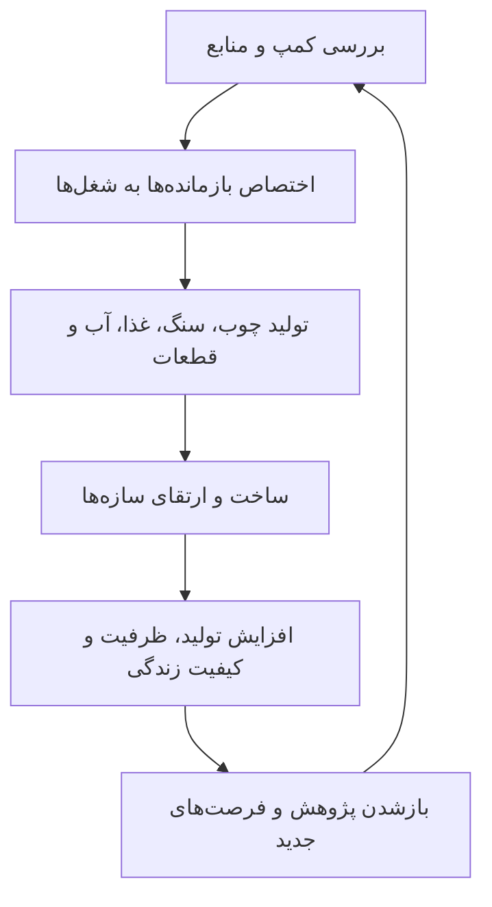
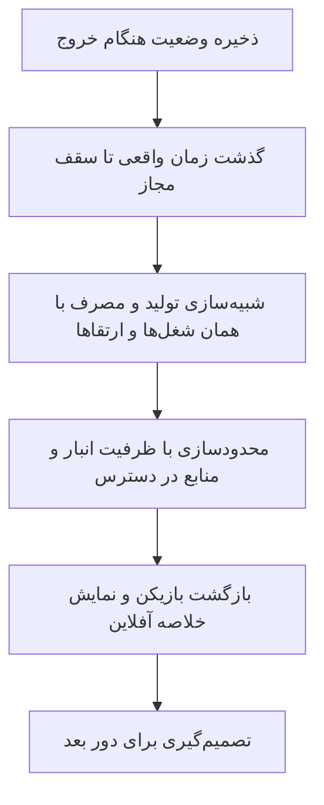

# THE LAST CIVILIZATION
## سند جامع طراحی بازی و مشخصات اجرایی برای Codex

> **نسخه سند:** ۱.۰ — مبنای شروع توسعه  
> **زبان سند:** فارسی (شناسه‌های فنی و نام کلاس‌ها انگلیسی)  
> **نوع خروجی مورد انتظار:** یک بازی **قابل اجرا و قابل بازی**، نه صرفاً تصویر، موکاپ، صفحه نمایشی یا ویدئو  
> **ژانر:** Idle / Colony Management / Civilization Rebuilding / Light Survival  
> **نام کاری بازی:** The Last Civilization (در فایل ایده اولیه: Last Civilization)  
> **پلتفرم هدف پیشنهادی:** موبایل Android و iOS؛ اجرای دسکتاپ برای توسعه و تست  
> **موتور اجرایی پیشنهادی برای شروع از صفر:** Godot 4.x + GDScript  
> **قالب نمایشی پیشنهادی نسخه نخست:** Landscape با نسبت 16:9، دوربین ایزومتریک 3D/2.5D  
> **سطح بلوغ:** ایده اولیه تأیید شده؛ مشخصات عددی و معماری زیر پیشنهاد اجرایی نسخه اول هستند و هنوز به تصویب مستقل نرسیده‌اند.

---

# ۰. این فایل را چگونه بخوانیم؟ — دستور مستقیم برای Codex

این سند هم‌زمان چهار نقش دارد:

1. **Product Vision:** بازیکن قرار است چه احساسی داشته باشد و بازی چه تجربه‌ای بدهد؟
2. **Game Design Document (GDD):** مکانیک‌ها، قوانین، اقتصاد، مراحل پیشرفت و رابط کاربری چیست؟
3. **Technical Design Document (TDD):** سیستم‌ها، داده‌ها، ساختار پروژه و الگوریتم‌ها چگونه پیاده‌سازی شوند؟
4. **Implementation Plan:** Codex کار را با چه ترتیبی انجام دهد و برای هر مرحله چه تستی ارائه کند؟

## قواعد کاری Codex

- پیش از نوشتن کد، کل سند را بخوان؛ بین «الزامات قطعی ایده» و «تصمیم‌های اجرایی پیشنهادی» فرق بگذار.
- **هدف اول، ساخت یک Vertical Slice قابل بازی است.** با منوی نمایشی، تصویر ثابت، اسلایدشو یا داشبورد بدون شبیه‌سازی واقعی بازی را تمام‌شده تلقی نکن.
- اگر مخزن پروژه خالی است، طبق پیشنهاد این سند از Godot 4.x و GDScript استفاده کن. اگر در مخزن از قبل یک موتور/فریم‌ورک تعیین شده، آن را خودسرانه تغییر نده؛ همین GDD را به معماری موجود نگاشت کن.
- ویژگی‌های `MUST` را در فاز MVP اجرا کن؛ ویژگی‌های `LATER` را فقط برای توسعه‌پذیری در نظر بگیر، نه اینکه از ابتدا همه را بسازی.
- برای نداشتن مدل، صدا، فونت یا تکسچر تجاری متوقف نشو؛ از دارایی‌های موقت تمیز و منظم، هندسه ساده سه‌بعدی و اشیای Placeholder استفاده کن.
- داده‌های اقتصاد بازی را در فایل‌های Data نگه دار، نه در ده‌ها اسکریپت هاردکد.
- هر اقدام بازی باید **تغییر واقعی GameState** ایجاد کند و تا حد ممکن **اثر قابل مشاهده در جهان** داشته باشد.
- پس از هر فاز، پروژه را اجرا کن، ارورها را برطرف کن، تست‌ها را اجرا کن و آنچه ساخته شده/نشده را دقیق گزارش بده.
- هیچ ادعایی درباره اجرای موفق تست یا Export نکن مگر واقعاً انجام شده باشد. اگر Godot یا Android SDK در محیط موجود نیست، این محدودیت را واضح گزارش کن و تست‌های قابل انجام را اجرا کن.
- همه تعاملات با ماوس روی دسکتاپ و با لمس روی موبایل قابل استفاده باشند.
- **هیچ سیستم پرداخت، تبلیغات، سرور، لاگین، حساب کاربری یا داده‌برداری شخصی در MVP لازم نیست.**
- تصمیم‌های بدون پاسخ که برای پیشرفت غیرضروری‌اند را مطابق پیش‌فرض همین سند حل کن؛ انتخاب را در `DECISIONS.md` ثبت کن.

## قرارداد اولویت

- `LOCKED`: ریشه در سند ایده اولیه یا جهت بصری تثبیت‌شده در همین گفتگو دارد و نباید بی‌دلیل تغییر کند.
- `PROPOSED`: طراحی تکمیلی و عدد پیشنهادی برای اینکه نسخه قابل ساخت باشد؛ می‌توان پس از پلی‌تست بالانسش کرد.
- `MVP`: حداقل نسخه‌ای که باید واقعاً کار کند.
- `LATER`: قابلیت آتی؛ نباید مانع تحویل MVP شود.

---

# ۱. منشأ طراحی، محدودیت‌ها و مرز فرضیات

## ۱.۱ موارد صریح سند اصلی ایده (`LOCKED`)

مبنای این بخش فایل `01_Last_Civilization.md` از بسته مفهومی چهار بازی است:

- تمدن بشری فروپاشیده است.
- بازی با **دقیقاً شش بازمانده** آغاز می‌شود.
- بازیکن از یک کمپ کوچک و شکننده، یک اجتماع زنده و سپس یک تمدن رو به رشد می‌سازد.
- ژانر بازی **Idle / Management** موبایلی است؛ با تعداد کم تصمیم‌های معنادار، نه کلیک‌کردن بی‌وقفه.
- منابع اصلی آغازین **چوب، سنگ، غذا و آب** هستند.
- بازیکن به انسان‌ها شغل می‌دهد، سازه‌های ضروری می‌سازد و منابع را مدیریت می‌کند.
- تولید و پیشرفت در زمان نبودن بازیکن نیز ادامه می‌یابد.
- ساختمان‌های تازه ظرفیت بقا، تولید، پژوهش و جمعیت را افزایش می‌دهند.
- گسترش باید **در خود نقشه** دیده شود، نه فقط در افزایش اعداد.
- محیط: ویرانه‌های دنیای مدرن، پوشش گیاهی روی ساختمان‌های قدیمی، کمپ، نورهای گرم، کارگاه، مزرعه، انبار و آدم‌های کوچکی که بین ساختمان‌ها حرکت می‌کنند.
- حس بازی **امیدبخش، مقاوم، متفکرانه و حماسیِ آرام** است؛ نه وحشت و خشونت.
- هنر: سه‌بعدی استایلایز یا 2.5D با سیلوئت واضح، نورپردازی اتمسفریک و رابط ساده و خوانا.

## ۱.۲ چیزهایی که سند اصلی مشخص نکرده (`PROPOSED` در ادامه)

موتور، زاویه دقیق دوربین، نرخ تولید منابع، قیمت ساختمان‌ها، نقشه، ابعاد شبکه، شیوه افزایش جمعیت، الگوریتم آفلاین، جزئیات نوارهای UI، داستان‌های مأموریتی، درخت فناوری، طول جلسه بازی، چالش‌ها و معماری کد **در فایل اولیه تعریف نشده‌اند**. مقادیر این سند برای قابل پیاده‌سازی کردن ایده پیشنهاد شده‌اند؛ آنها را با «اطلاعات قطعی منبع» اشتباه نگیر.

## ۱.۳ جهت هنری پذیرفته‌شده در گفتگو (`LOCKED` برای نمونه اولیه)

تصاویر مرجع تأییدشده توسط کاربر برای بازی اول، ترکیبی از **محیط ایزومتریک قابل نظارت** و **کیفیت تمیز و رنگی بازی‌های مدیریتی** هستند. در شات اول کمپ با چادرهای اولیه، حدود شش بازمانده، آتش مرکزی، منابع و بقایای شهر متروکه دیده می‌شود؛ در شات دوم از همان لوکیشن و زاویه، کارگاه، کشتزار، انبار، آب‌رسانی و حرکت افراد بیشتر دیده می‌شود.

تصاویر **مبنای سبک و احساس‌اند، نه Source of Truth برای اعداد، شخصیت‌های دقیق یا قوانین بازی**. نباید از روی تصویر ثابت، بازی غیرتعاملی ساخت.

---

# ۲. تعریف یک‌جمله‌ای و Pitch

**The Last Civilization** یک بازی مدیریتی-Idle با دوربین ایزومتریک است که در آن بازیکن پس از سقوط تمدن، رهبری شش بازمانده را بر عهده می‌گیرد؛ به آنها کار می‌دهد، منابع تولید می‌کند، با ساخت چادر، مزرعه، کارگاه و زیرساخت‌های بهتر، یک کمپ فقیر را به سکونتگاهی زنده و در بلندمدت به تمدنی نو تبدیل می‌کند.

### تگ‌لاین پیشنهادی

> «از شش بازمانده، آینده بشریت را بساز.»

### مخاطب هدف پیشنهادی

- علاقه‌مند به مدیریت منابع، شهرسازی ساده، ارتقا و مشاهده پیشرفت تدریجی.
- بازیکن موبایل که در هر ورود چند تصمیم کوتاه می‌گیرد و سپس پیشرفت را تماشا می‌کند.
- نه مخاطب RTS رقابتی؛ نه شبیه‌ساز اکسل؛ نه بازی مبارزه و دفاع از قلعه.

### سه سؤال ارزیابی کیفیت

1. آیا بعد از ۳۰ ثانیه می‌فهمم بازماندگان **مشغول چه کاری** هستند؟
2. آیا ساخت یک سازه جدید **ظاهر کمپ و رفتار افراد** را تغییر می‌دهد؟
3. آیا پس از بستن و بازکردن بازی، پیشرفت آفلاین **واقعی، منطقی و شفاف** است؟

اگر پاسخ هرکدام «نه» باشد، تجربه مرکزی بازی هنوز تکمیل نشده است.

---

# ۳. ستون‌های اصلی طراحی (Design Pillars)

| ستون | معنی در تجربه بازیکن | نمونه ملموس |
|---|---|---|
| ۱. آدم‌ها مهم‌اند | هر نفر محدود و ارزشمند است | انتقال یک بازمانده از چوب‌بری به آب‌رسانی، تولید را جابه‌جا می‌کند |
| ۲. نقشه زنده است | کمپ یک اکوسیستم واقعی دیده می‌شود | فرد از مزرعه برداشت می‌کند، جعبه حمل می‌کند و به انبار می‌رود |
| ۳. پیشرفت قابل دیدن است | هر ارتقا شکل فیزیکی دارد | کارگاه تازه ساخته می‌شود، دودکش روشن می‌شود، قفسه‌ها پر می‌شوند |
| ۴. Idle، نه بی‌اختیاری | بازی هنگام خروج پیش می‌رود، اما انتخاب‌ها ارزش دارند | اختصاص درست نیروها در طول غیبت، منابع بیشتری ایجاد می‌کند |
| ۵. امید به جای ترس | سختی قابل مدیریت است، نه تنبیه‌کننده | کمبود آب سرعت کار را کم می‌کند؛ بازی ناگهان تمام نمی‌شود |
| ۶. ساده در ورود، عمیق در ادامه | یادگیری سریع، لایه‌های بیشتر در آینده | شروع با چهار منبع و چند شغل، سپس پژوهش و بهینه‌سازی |

### ضدالگوها (این بازی نباید باشد)

- بازی فقط متشکل از دکمه‌های «+1»، «Upgrade» و یک پس‌زمینه بی‌حرکت.
- بازی تاور دیفنس، نبرد دائمی، ارتش‌سازی یا PvP.
- بازی‌ای که تمام منابع را تنها با Tap کردن تولید کند.
- یک شبیه‌ساز زندگی‌سخت که در آن کاربر با یک اشتباه کل جمعیت را از دست دهد.
- بازی سه‌بعدی واقع‌گرایانه سنگین که روی موبایل متوسط اجرا نشود.
- تقلید مستقیم از رابط کاربری، نقشه یا دارایی‌های یک بازی تجاری خاص.

---

# ۴. داستان، جهان و منطق روایی

## ۴.۱ پیش‌زمینه (`LOCKED` در سطح ایده؛ جزئیات `PROPOSED`)

فروپاشی عظیمی رخ داده؛ علت دقیق عمداً در ابتدا روشن نیست. سال‌ها گذشته و گیاهان از داخل بزرگراه‌ها، ساختمان‌ها و قطارهای رهاشده بیرون آمده‌اند. گروهی شش‌نفره به یک فضای امن در حاشیه شهر ویران رسیده‌اند. آنها هنوز هیچ تمدنی ندارند: تنها آتش، سرپناه موقت، ابزار دستی و امید.

از همان دقیقه اول، تضاد دو زمان دیده می‌شود: **شهر بزرگ و خاموش گذشته** در دوردست، و **کمپ کوچک و گرم امروز** در پیش‌زمینه.

## ۴.۲ انگیزه بازیکن

هدف فقط انباشتن پول نیست؛ «ساختن جایی است که مردم دوباره بتوانند زندگی کنند». پیشرفت داستان با دستاوردهای محیطی منتقل می‌شود:

1. روشن شدن نخستین آتش و برپا شدن سرپناه.
2. شکل‌گیری غذای پایدار و آب سالم.
3. ایجاد نخستین کارگاه و بازیافت ابزار.
4. آمدن بازماندگان تازه پس از امن و پایدار شدن کمپ.
5. روشن شدن چراغ‌ها، راه‌ها و پژوهشگاه.
6. در آینده: راه‌اندازی ارتباط با سکونتگاه‌های دیگر و بازسازی بخش‌های بیشتری از جهان.

## ۴.۳ لحن نوشتاری

پیام‌ها کوتاه، انسانی و امیدوارکننده. مثال:

- «شش نفر. یک آتش. یک فرصت تازه.»
- «با ساخت اولین مزرعه، غذای فردایمان مطمئن‌تر می‌شود.»
- «کارگاه آماده است؛ می‌توانیم ابزارهای بهتری بسازیم.»
- «کمپ کوچک ما دارد به یک خانه تبدیل می‌شود.»

از شعارهای متعدد، متون خیلی طولانی، زبان آخرالزمانی خشن و داستان اجباری پرهیز کن.

---

# ۵. تجربه کاربر: از لحظه ورود تا ۳۰ دقیقه اول

## ۵.۱ شات افتتاحیه

- دوربین زاویه‌دارِ ثابت نسبی از بالا به یک منطقه قابل ساخت نگاه می‌کند.
- اطراف منطقه، ساختمان بتنی ترک‌خورده، پل متروک، بدنه قطار/اتوبوس رهاشده و گیاهان دیده می‌شوند.
- مرکز زمین: آتش کم‌نور و یک میدان خاکی.
- دو چادر ساده، چند جعبه، چوب و چند قطعه سنگ.
- **دقیقاً ۶ شخصیت کوچک** در صحنه حاضرند؛ برخی دور آتش، برخی آماده کار.
- HUD بالا: تعداد جمعیت و چهار منبع اصلی؛ پایین: ساخت، مردم، پژوهش و ارتقا.
- یک راهنمای کوچک می‌گوید: «برای شروع، ساخت مزرعه را انتخاب کن.»

## ۵.۲ آموزش عملی ۰ تا ۵ دقیقه (`MVP`)

1. بازیکن روی **People / مردم** می‌زند و لیست ۶ بازمانده و شغل هرکدام را می‌بیند.
2. یک بازمانده را برای جمع‌آوری چوب یا غذا تخصیص می‌دهد؛ فرد در صحنه به سمت محل کار حرکت می‌کند.
3. نوار منابع با گذر زمان زیاد می‌شود؛ تغییرات **بر دقیقه** در پنل منبع قابل دیدن است.
4. بازیکن **Build / ساخت** را باز می‌کند، «باغچه / مزرعه کوچک» را انتخاب می‌کند.
5. محل مجاز روی شبکه سبز می‌شود؛ محل نامجاز قرمز. با Tap، هزینه کسر و **Construction Site** ساخته می‌شود.
6. یکی از افراد آزاد به محل می‌رود و کار ساخت را آغاز می‌کند؛ نوار پیشرفت بالای سازه دیده می‌شود.
7. ساختمان کامل می‌شود؛ تصویرِ سازه تغییر کرده و تولید غذا بهبود می‌یابد.
8. مأموریت آموزشی تکمیل و پاداش اندکی اهدا می‌شود.

## ۵.۳ دقیقه ۵ تا ۱۵ (`MVP`)

- بازیکن با گرفتن **Scrap / قطعات بازیافتی** از بقایای شهر، منابع تولیدی تازه‌ای پیدا می‌کند.
- اولین **Workshop / کارگاه** باز می‌شود؛ با ساخت آن، نور گرم پنجره‌ها و دود ملایم دیده می‌شود.
- ساختمان جدید گزینه‌های پژوهش محدود را باز می‌کند.
- کاربر کمبود احتمالی غذا و آب را با تقسیم شغل‌ها رفع می‌کند.
- ظرفیت انبار ممکن است محدودکننده باشد؛ بازیکن انگیزه ارتقای آن را می‌بیند.

## ۵.۴ دقیقه ۱۵ تا ۳۰ (`PROPOSED`)

- نخستین پژوهش کوچک انجام می‌شود.
- ۱ بازمانده تازه از بیرون کمپ درخواست ورود می‌کند؛ اگر سرپناه کافی و ذخیره غذا و آب مناسب باشد، بازیکن او را می‌پذیرد.
- کمپ از شش به هفت نفر تبدیل می‌شود؛ انسان جدید یک واحد کار واقعی است.
- چند ساختمان روشن و ۲–۳ مسیر حرکت فعال در نقشه دیده می‌شود.
- بازی پیشنهاد می‌دهد برای چند دقیقه خارج شود و بازگردد تا **Offline Production Summary** را ببیند.

## ۵.۵ حس هر جلسه بازی

- ورود ۳۰ تا ۹۰ ثانیه: جمع‌کردن نتیجه پیشرفت، دیدن مشکلات، اختصاص نیرو، ساخت/ارتقا، خروج.
- ورود ۳ تا ۷ دقیقه: برنامه‌ریزی کوتاه و تماشای عملیات.
- اگر بازیکن بخواهد ۱۵ دقیقه بماند نیز باید چیزهایی برای تصمیم‌گیری داشته باشد، نه الزام به ضربه‌زدن مداوم.

---

# ۶. حلقه گیم‌پلی (Core Loop) و حلقه پیشرفت (Meta Loop)

## ۶.۱ Core Loop



## ۶.۲ حلقه جانبی Idle



## ۶.۳ Meta Loop بلندمدت (`LATER`)

کمپ موقت → سکونتگاه پایدار → روستای بازسازی‌شده → شهر کوچک → جامعه پژوهشی → تمدن نو. این بخش فعلاً چشم‌انداز است؛ با ساخت تمام شهر بزرگ شروع نکن.

---

# ۷. دوربین، نقشه و تعامل سه‌بعدی

## ۷.۱ مشخصات پیشنهادی نقشه (`PROPOSED`)

- جهان: یک صحنه سه‌بعدی با دوربین **Orthographic** و زاویه ایزومتریک نزدیک 35–45 درجه نسبت به افق.
- زمین قابل ساخت MVP: شبکه منطقی `28 × 22` سلولی؛ شبکه واقعی در فایل تنظیمات قابل تغییر باشد.
- ابعاد هر سلول منطقی: `2 × 2` واحد جهانی؛ ساختمان ممکن است 2×2، 3×3 یا 4×3 سلول اشغال کند.
- بخش قابل ساخت یک منطقه تقریباً چهارگوش با شکل طبیعی است. جهان اطراف تزئینی و غیرقابل ساخت است.
- اطراف: خرابه‌ها، درخت‌ها، پل شکسته، بقایای سازه‌های مدرن؛ **محیط صرفاً پس‌زمینه است و با محل ساخت اشتباه نشود**.
- شش جایگاه Resource Node: چوب/درخت، سنگ/توده سنگ، گیاه خوراکی، آب، بقایای فلزی، محل مرکزی کمپ.
- یک راه اصلی میان میدان کمپ و منابع؛ مسیرهای دیگر با Pathfinding قابل طی باشند.

## ۷.۲ چرخش و حرکت دوربین

| تعامل | موبایل | دسکتاپ | اولویت |
|---|---|---|---|
| انتخاب شیء/شخصیت | Tap | Left Click | MUST |
| جابه‌جایی دوربین | Drag تک‌انگشتی روی فضای خالی | Middle Drag یا Right Drag | MUST |
| زوم | Pinch | Mouse Wheel | MUST |
| چرخش دوربین | غیرفعال در MVP | غیرفعال در MVP | MUST |
| بازگشت به کمپ | دکمه خانه | دکمه خانه | MUST |
| قرار دادن ساختمان | Tap روی شبکه | Click | MUST |
| لغو ساخت | دکمه Cancel | Escape | MUST |

- دوربین به داخل مرزهای منطقی محدود شود؛ نباید کل نقشه از کادر خارج شود.
- HUD جزو لایه UI است و هنگام Pan/Zoom جابه‌جا نشود.
- کلیک روی UI نباید هم‌زمان به زمین برخورد کند.
- ساختمان جدید بعد از ساخته شدن همچنان از نظر دوربین و مسیر قابل دسترسی باشد.

## ۷.۳ خوانایی بازی

- بازمانده‌ها باید از نمای زوم دور هم قابل تفکیک باشند.
- از توده‌های ریز اشیای بی‌معنا خودداری شود؛ چوب، سنگ، مزرعه، آب و کارگاه از طریق رنگ/سیلوئت قابل شناسایی باشند.
- نوار وضعیت و افکت‌ها نباید روی یکدیگر انباشته شوند.
- مسیرهای حرکت افراد و جایگاه ساختمان‌ها در یک نگاه قابل فهم باشد.

---

# ۸. کنترل‌های بازیکن و چرخه تعامل

بازیکن مستقیماً شخصیت‌ها را با کنترل RTS حرکت نمی‌دهد؛ **شغل و اولویت تعیین می‌کند** و AI وظایف را اجرا می‌کند.

### تعامل با Survivor

Tap روی انسان → پنل با نام، شغل، وضعیت، راندمان و دکمه «تغییر شغل» → انتخاب شغل جدید → یافتن نزدیک‌ترین نقطه کار مناسب → حرکت و شروع کار.

### تعامل با Resource Node

Tap روی درخت/سنگ/آب → نوع منبع، نرخ تولید پایه، افراد مشغول، دکمه «اختصاص نیرو» و مسیر تخصیص.

### تعامل با ساختمان

Tap روی ساختمان → سطح فعلی، تولید، نیازمندی‌ها، افراد مشغول، هزینه ارتقا، زمان ارتقا، دکمه Upgrade و گزینه Information.

### تعامل با ساخت‌وساز

Build → انتخاب ساختمان → نمایش Ghost نیمه‌شفاف روی زمین → بررسی برخورد و مسیر → Preview هزینه و زمان → Confirm → ساخت `ConstructionSite` → تکمیل توسط Builder → جایگزینی با مدل کامل ساختمان.

### لغو ساخت

- قبل از تأیید: هیچ هزینه‌ای کسر نشود.
- پس از شروع ساخت و قبل از تکمیل: در MVP بازگشت **۸۰٪ مواد پرداخت‌شده** (`PROPOSED`) و آزادسازی شبکه؛ اجرای منطقی و تست‌شده.
- دکمه Cancel باید در هر دو حالت کار کند.

---

# ۹. بازماندگان و سیستم شغل‌ها

## ۹.۱ شروع بازی (`LOCKED`)

- دقیقاً **۶ انسان زنده** در کمپ هستند.
- همه جزو جمعیت، واحد مصرف غذا/آب و نیروی کار محسوب می‌شوند.
- هیچ نفر هفتمی پیش از رویداد جذب جمعیت ظاهر نشود.
- نام، لباس و چهره می‌تواند متنوع باشد؛ هویت کارگر از شغل و ابزارش مشخص باشد.

## ۹.۲ مدل داده هر Survivor (`MVP`)

```json
{
  "id": "survivor_001",
  "display_name": "آرمان",
  "role": "woodcutter",
  "visual_variant": 0,
  "state": "working",
  "assigned_target_id": "node_forest_01",
  "efficiency": 1.0,
  "world_position": [6.0, 0.0, 4.0],
  "carried_resource": null,
  "carried_amount": 0
}
```

`display_name` نمونه است، نه نام اجباری. برای همه موجودیت‌ها از ID پایدار و مستقل از نام نمایشی استفاده کن.

## ۹.۳ فهرست شغل‌های MVP

| شناسه | نام نمایشی | کار | تولید پایه پیشنهادی / دقیقه / نفر | در دسترس |
|---|---|---|---:|---|
| `woodcutter` | چوب‌بر | جمع‌آوری چوب | ۴ چوب | آغاز |
| `stone_gatherer` | سنگ‌جمع‌کن | جمع‌آوری سنگ | ۲ سنگ | آغاز |
| `forager` | خوراک‌جمع‌کن | برداشت غذای طبیعی | ۳ غذا | آغاز |
| `water_collector` | آب‌رسان | جمع‌آوری آب | ۳ آب | آغاز |
| `scavenger` | بازیافت‌گر | جمع‌آوری قطعات از خرابه | ۱ قطعه | آغاز |
| `builder` | سازنده | پیشبرد ساخت | تولید منبع ندارد | آغاز |
| `farmer` | کشاورز | تولید غذا از مزرعه | ۵٫۵ غذا در مزرعه فعال | پس از مزرعه |
| `technician` | تکنسین | کار در کارگاه | ۱٫۵ امتیاز پژوهش | پس از کارگاه |
| `idle` | آزاد | آماده تخصیص و راه‌رفتن | ندارد | آغاز |

اعداد، **پایه بالانس** هستند و بعداً از داده تغییر می‌کنند؛ دقت اعشاری در شبیه‌سازی مجاز، نمایش HUD گرد شده باشد.

## ۹.۴ تقسیم کار اولیه (`PROPOSED`)

| تعداد | شغل |
|---:|---|
| ۱ | چوب‌بر |
| ۱ | سنگ‌جمع‌کن |
| ۱ | خوراک‌جمع‌کن |
| ۱ | آب‌رسان |
| ۱ | بازیافت‌گر |
| ۱ | آزاد، برای ساختمان‌سازی |

جمع: **۶ نفر**. بازیکن بتواند با دو کلیک این ترکیب را عوض کند؛ ولی بازی بدون تخصیص دستی اولیه کاملاً متوقف نشود.

## ۹.۵ وضعیت‌های AI

`IDLE → MOVING_TO_JOB → WORKING → CARRYING → RETURNING → WORKING` و در کار ساخت: `MOVING_TO_CONSTRUCTION → BUILDING → IDLE/RESUME`.

- حرکت انسان‌ها تزئینی محض نباشد؛ حداقل وضعیت حرکت و وضعیت کار با شغل فعلی مرتبط باشد.
- اگر مسیر موقتاً بسته شد، Path مجدد حساب شود و انسان گیر نکند.
- تغییر شغل وسط حرکت باید کار قبلی را تمیز لغو کند.
- اگر ساختمان/نقطه کار حذف شد، فرد به `idle` بازگردد و پیام خطای سیستمی ندهد.
- برای MVP می‌توان مقدار تولید را در GameState بر اساس نرخ زمانی محاسبه کرد و حرکت NPC را نمایش همگام آن قرار داد؛ نیاز نیست هر واحد چوب فیزیکی جداگانه حمل شود.
- **نباید تولید به Frame Rate وابسته باشد**.

## ۹.۶ حداکثر مشاغل

- هر شغل محدودیت طبیعی دارد (مثلاً مزرعه کوچک حداکثر ۲ کشاورز، کارگاه سطح ۱ حداکثر ۱ تکنسین).
- شغل‌های برداشت اولیه می‌توانند چند نفر بگیرند اما برای MVP ظرفیت Node را ۳ نفر قرار بده.
- اختصاص یک نفر به دو شغل هم‌زمان ممنوع است.
- در صورت نیاز به Builder، ابتدا بازمانده آزاد استفاده شود؛ افراد حیاتی آب/غذا بدون اجازه جابه‌جا نشوند.

---

# ۱۰. منابع، ظرفیت انبار و اقتصاد پایه

## ۱۰.۱ انواع منابع

| کلید فنی | عنوان | نقش | MVP |
|---|---|---|---|
| `wood` | چوب | ساختمان‌ها و ابزار | MUST |
| `stone` | سنگ | ساختمان‌ها و زیرساخت | MUST |
| `food` | غذا | مصرف جمعیت و رشد | MUST |
| `water` | آب | مصرف جمعیت و رشد | MUST |
| `scrap` | قطعات بازیافتی | کارگاه/پژوهش | MUST |
| `research` | دانش/امتیاز پژوهش | بازکردن فناوری | MUST در فاز دوم MVP |
| `metal` | فلز فرآوری‌شده | ارتقاهای پیشرفته | LATER |
| `energy` | برق | زیرساخت پیشرفته | LATER |

**مهم:** در UI اولیه نیازی نیست ۸ منبع هم‌زمان بالای صفحه نشان داده شود؛ چهار منبع پایه اولویت دارند و Scrap/Research می‌توانند در پنل ثانویه باشند.

## ۱۰.۲ مقدار شروع و سقف ذخیره (`PROPOSED`)

| منبع | مقدار آغاز | ظرفیت پیش‌فرض |
|---|---:|---:|
| چوب | ۴۰ | ۱۵۰ |
| سنگ | ۲۵ | ۱۵۰ |
| غذا | ۳۰ | ۱۲۰ |
| آب | ۳۰ | ۱۲۰ |
| قطعات بازیافتی | ۰ | ۸۰ |
| دانش | ۰ | بدون سقف در MVP |

- از اعداد حقیقی برای اقتصاد استفاده کن؛ نمایش مقادیر به‌صورت عدد صحیح یا یک رقم اعشار در جزئیات.
- هیچ منبعی هرگز منفی نشود.
- وقتی ظرفیت پر است، تولید مازاد ذخیره نشود؛ در UI نماد **Storage Full** نمایش داده شود.
- ظرفیت انبار **پیش‌فرض مشترک هر نوع منبع با حد جداگانه** است، نه یک سبد مشترک جمع‌شونده. بعداً می‌توان از انبارهای تخصصی استفاده کرد.

## ۱۰.۳ هزینه مصرف جمعیت (`PROPOSED`)

هر بازمانده در هر دقیقه واقعی:

- `0.25 food`
- `0.30 water`

پس در آغاز با ۶ نفر:

- مصرف غذا `6 × 0.25 = 1.50` واحد/دقیقه
- مصرف آب `6 × 0.30 = 1.80` واحد/دقیقه

با تقسیم اولیه شغل‌ها، درآمد ناخالص غذا ۳ و آب ۳ در دقیقه است؛ بنابراین کمپ در آغاز **اندکی مازاد** دارد. این انتخاب عمدی است تا بازیکن در چند دقیقه اول دچار شکست ناگهانی نشود.

## ۱۰.۴ فرمول نرخ تولید

```text
job_rate_per_min = base_job_rate
                 × building_multiplier
                 × research_multiplier
                 × morale_multiplier

resource_delta_for_step = job_rate_per_min × elapsed_seconds / 60
```

- همه ضریب‌ها به طور پیش‌فرض `1.0` هستند؛ مگر با ساختمان/پژوهش تغییر کنند.
- `building_multiplier` فقط وقتی آن شغل در سازه یا سیستم مرتبط فعال است اعمال شود.
- مصرف غذا/آب جدا از تولید محاسبه شود؛ برای شبیه‌سازی دقیق، ترتیب مرحله‌ها ثابت و تست‌پذیر باشد.
- هیچ ضرب‌کننده پنهان و غیرقابل توضیح اضافه نشود.

## ۱۰.۵ نمونه محاسبه ۵ دقیقه

با ترکیب اولیه، بدون ارتقا، بدون پرشدن ظرفیت و بدون ساخت:

| منبع | تغییر ناخالص | مصرف | تغییر خالص |
|---|---:|---:|---:|
| چوب | `4×5 = +20` | ۰ | +۲۰ |
| سنگ | `2×5 = +10` | ۰ | +۱۰ |
| غذا | `3×5 = +15` | `1.5×5 = −7.5` | +۷٫۵ |
| آب | `3×5 = +15` | `1.8×5 = −9` | +۶ |
| قطعات | `1×5 = +5` | ۰ | +۵ |

نتیجه در صورت ثابت‌ماندن همه شرایط:

- چوب: ۶۰
- سنگ: ۳۵
- غذا: ۳۷٫۵
- آب: ۳۶
- قطعات: ۵

این مثال **تست واحد مرجع** است؛ بدون مصرف ناشی از ساخت باید دقیقاً همین اعداد به دست آید.

## ۱۰.۶ کمبود غذا یا آب

فلسفه بازی تنبیه شدید نیست. اگر غذای کافی یا آب کافی برای مصرف یک مرحله وجود نداشت:

- موجودی در صفر متوقف می‌شود، منفی نمی‌شود.
- وضعیت `shortage_food` یا `shortage_water` فعال می‌شود.
- کارایی همه مشاغل در کمبود مربوطه با ضریب ملایم کاهش می‌یابد (پیشنهاد: `0.65` برای یک کمبود و `0.50` برای هر دو؛ بیش از این تضعیف نکن).
- اگر منبع دوباره موجود شد، وضعیت با وقفه کوتاه یا در Tick بعد بازیابی شود تا Flicker ایجاد نشود.
- هیچ مرگ دائمی و Game Over در MVP وجود ندارد.
- UI هشدار واضح و راه‌حل «به جمع‌آوری آب/غذا نیرو بده» نمایش دهد.

برای جلوگیری از قفل‌شدن اقتصاد در وضعیتی که تولیدکننده به‌دلیل کمبود خیلی ضعیف می‌شود، سقف افت راندمان را رعایت کن.

---

# ۱۱. ساختمان‌ها و سیستم ساخت

## ۱۱.۱ اصطلاحات

- `Camp Center`: میدان یا آتش مرکزی؛ مرجع تمدن و مرکز نقشه.
- `Construction Site`: مدل موقت یک سازه در حال ساخت.
- `Building`: سازه کامل با سطح، ظرفیت، شغل و افکت.
- `Upgrade`: بهبود سازه موجود؛ ظاهر و قابلیت آن بهتر می‌شود.

## ۱۱.۲ جدول ساختمان‌های اولیه (`PROPOSED`)

| ID | نام | ابعاد شبکه | هزینه ساخت | زمان با ۱ سازنده | فایده | وضعیت |
|---|---|---|---|---:|---|---|
| `camp_center` | مرکز کمپ | ۳×۳ | شروع رایگان | آماده | نقطه مرکزی، مأموریت و سطح کمپ | شروع |
| `tent` | چادر ساده | ۲×۲ | دو واحد از ابتدا؛ ساخت جدید: ۱۸ چوب + ۶ سنگ | ۳۰ ثانیه | ظرفیت ۳ نفر | MVP |
| `small_farm` | مزرعه کوچک | ۳×۲ | ۲۰ چوب + ۱۰ سنگ | ۲۰ ثانیه | پذیرش ۲ کشاورز؛ هر نفر ۵٫۵ غذا/دقیقه | MVP |
| `water_collector` | ایستگاه آب | ۲×۲ | ۲۵ چوب + ۱۲ سنگ | ۳۰ ثانیه | تا ۲ آب‌رسان؛ هر نفر ۴٫۵ آب/دقیقه | MVP |
| `wood_yard` | محوطه چوب | ۲×۲ | ۲۵ چوب + ۱۰ سنگ | ۳۵ ثانیه | چوب‌برهای مرتبط +۲۵٪ تولید | MVP |
| `stone_pit` | کارگاه سنگ | ۲×۲ | ۲۰ چوب + ۱۵ سنگ | ۴۰ ثانیه | سنگ‌جمع‌کن‌های مرتبط +۲۵٪ تولید | MVP |
| `workshop` | کارگاه بازیافت | ۳×۳ | ۳۰ چوب + ۲۰ سنگ + ۴ قطعه | ۵۰ ثانیه | بازشدن تکنسین و دانش | MVP فاز ۲ |
| `warehouse` | انبار | ۳×۲ | ۳۵ چوب + ۲۰ سنگ | ۵۰ ثانیه | چوب/سنگ +۱۰۰، غذا/آب +۸۰، قطعات +۵۰ ظرفیت | MVP فاز ۲ |
| `research_hut` | اتاق پژوهش | ۳×۳ | ۴۰ چوب + ۲۵ سنگ + ۸ قطعه | ۶۰ ثانیه | پژوهش پیشرفته در آینده | LATER |
| `solar_station` | برق خورشیدی | ۳×۳ | تعیین نشده | تعیین نشده | برق و روشنایی شهر | LATER |
| `clinic` | درمانگاه | ۳×۲ | تعیین نشده | تعیین نشده | سلامت و رفاه | LATER |

در دو چادر اولیه، مجموع ظرفیت `2 × 3 = 6` است. برای نفر هفتم باید چادر تازه یا سرپناه بهتر ساخته شود.

## ۱۱.۳ قوانین Build (`MVP`)

- ساختمان فقط روی شبکه خالی و قابل ساخت قرار بگیرد.
- در نقطه‌ای که مسیر حیاتی بین مرکز و منابع کاملاً مسدود می‌شود، قرار دادن ممنوع باشد؛ ساده‌ترین راه این است که مناطق مسیر اصلی `no_build` باشند.
- هزینه بلافاصله پس از **Confirm** کسر شود، نه هنگام بازشدن Preview.
- اگر منابع کافی نیست، دکمه غیرفعال با فهرست کمبودها باشد.
- در صورت داشتن Builder آزاد، کار ساخت شروع شود؛ در غیر این صورت سایت در وضعیت **Awaiting Worker** بماند و بازیکن بتواند Builder تخصیص دهد.
- زمان پیشرفت ساخت با تعداد Builderها در MVP از **یک سازنده** بیشتر نشود تا پیچیدگی کم بماند.
- اتمام ساخت باید مدل ساختمان، مسیرها و نرخ اقتصاد را همگی به‌روزرسانی کند.
- پس از Load، یک پروژه ساخت نیمه‌کاره باید به همان شکل باقی بماند و ادامه پیدا کند.
- محدودیت ساخت تکراری و حداکثر تعداد ساختمان‌ها با Data کنترل شود؛ در MVP اجازه چند مزرعه/چادر و یک کارگاه سطح ۱ را بده.

## ۱۱.۴ ساختمان‌ها باید تفاوت تصویری داشته باشند

- چادر: پارچه، طناب، جعبه.
- مزرعه: حصار کوتاه، ردیف کشت، برداشت توسط کشاورز.
- ایستگاه آب: بشکه/مخزن، سطل، صدای آب.
- کارگاه: سقف چوبی، ابزار، پنجره روشن، دود بسیار ملایم.
- انبار: صندوق‌ها و بسته‌های منظم، نشان ظرفیت.
- ارتقا: حداقل یک قطعه مدل یا متریال و نور باید تغییر کند؛ فقط عدد لِوِل کافی نیست.

## ۱۱.۵ سیستم Upgrade (`MVP` محدود)

- سطح ۱ و ۲ برای `small_farm`, `water_collector`, `workshop`, `warehouse` کافی است.
- هزینه سطح ۲ نمونه: `round(1.8 × هزینه چوب و سنگ ساخت اولیه)` و برای Scrap در صورت داشتن، `round(1.5 × مقدار اولیه)`.
- تولید ساختمان سطح ۲: `1.25 × نرخ ساختمان سطح ۱`؛ ظرفیت نیروی انسانی تا زمانی که Data خلاف آن نگوید ثابت بماند.
- برای انبار سطح ۲: `+50%` نسبت به افزوده ظرفیت همان انبار، نه نسبت به کل ذخیره جهانی.
- زمان ارتقا `1.5 × زمان ساخت`.
- در طول ارتقا تولید آن ساختمان می‌تواند متوقف شود؛ این قانون باید در UI نوشته و در شبیه‌سازی رعایت شود.
- ارتقا هم باید با Construction/Upgrade Progress واقعی همراه باشد.

---

# ۱۲. سیستم تولید وابسته به ساختمان

## ۱۲.۱ شغل آزاد و شغل مستقر

- نقش‌های `woodcutter`, `stone_gatherer`, `forager`, `water_collector`, `scavenger` از آغاز به Resource Node مرتبط می‌شوند.
- وقتی سازه مرتبط ساخته شد، می‌توان شغل را به «محل کار تجهیزشده» منتقل کرد؛ مثلاً `farmer` فقط با مزرعه فعال است.
- یک فرد نمی‌تواند در یک زمان هم با `forager` غذا جمع کند و هم در مزرعه تولید کند.
- جدول Rates باید دقیقاً بر اساس شغل **فعلی و محیط فعال** خوانده شود.

## ۱۲.۲ نقش کارگاه

- کارگاه سطح ۱ یک جایگاه تکنسین ایجاد می‌کند.
- هر تکنسین در کارگاه سطح ۱ در هر دقیقه `1.5 research` تولید می‌کند.
- در MVP تولید پژوهش به مصرف دائمی Scrap وابسته نباشد تا اقتصاد نرم و قابل فهم بماند؛ Scrap برای **ساخت و Unlock** استفاده شود.
- ظاهر کارگاه هنگام کار: چراغ روشن، انیمیشن ابزار، دود ملایم.

## ۱۲.۳ مصرفی که اقتصاد را قفل نمی‌کند

در MVP از زنجیره‌های پیچیده «چوب → تخته → فلز → پیچ → ابزار» شروع نکن؛ این زنجیره‌ها برای فازهای بعدی‌اند. هدف نسخه اول **رابطه روشن بین افراد، منابع و ساخت‌وساز** است.

---

# ۱۳. جمعیت، خانه و رفاه

## ۱۳.۱ جمعیت پایه

- شروع: ۶ نفر، ظرفیت ۶ نفر.
- جمعیت هیچ‌گاه از ظرفیت مسکن بیشتر نمی‌شود.
- **یک نفر جدید فقط با رویداد ورود بازمانده به کمپ اضافه می‌شود**، نه با افزایش ناگهانی عدد بدون مدل انسانی.

## ۱۳.۲ ورود بازمانده جدید (`PROPOSED`)

شرایط ایجاد اولین رویداد مهاجرت:

1. دست‌کم یک مزرعه یا یک روش پایدار تولید غذا فعال باشد.
2. ذخیره غذا حداقل ۱۵ و آب حداقل ۱۵ باشد.
3. ظرفیت مسکن بیشتر از جمعیت فعلی باشد.
4. ۱۲ دقیقه از شروع کمپ گذشته باشد یا مأموریت «زندگی پایدار» تمام شده باشد.

پس از تحقق شرایط، حداکثر یک رویداد دعوت در صف قرار بگیرد؛ بازیکن با «پذیرش» فرد را جذب می‌کند. در MVP رویدادهای بعدی می‌توانند پس از حداقل ۵ دقیقه و فقط در صورت ظرفیت خالی دوباره ظاهر شوند.

## ۱۳.۳ سقف جمعیت MVP

حداکثر **۱۲ نفر** برای نمونه اولیه؛ از طریق فایل تنظیمات قابل تغییر باشد. لازم نیست بیش از ۱۲ شخصیت پیچیده هم‌زمان با انیمیشن کامل نمایش داده شود.

## ۱۳.۴ رضایت / Morale

- نسخه ابتدایی می‌تواند Morale را با مقدار ثابت `100` شروع کند.
- در صورت کمبود غذا/آب مقدار به‌آرامی کاهش یابد و پس از رفع کمبود بازیابی شود؛ اما وضعیت این متغیر باید صریح و قابل دیباگ باشد.
- به‌جای فرمول پیچیده نامعلوم، برای MVP تنها `morale_multiplier` قطعی و محدود تعریف کن: در وضعیت عادی ۱، در کمبود مطابق بخش ۱۰٫۶.
- سیستم‌های شادی، بهداشت، بیماری و فرزندآوری برای `LATER` هستند.

---

# ۱۴. پژوهش (Research) و فناوری

## ۱۴.۱ فلسفه

پژوهش باید **قفل قابلیت واقعی** باز کند، نه فقط شمارنده ظاهری. برای شروع، ۵ فناوری کافی است؛ درخت فناوری بزرگ را به بعد موکول کن.

## ۱۴.۲ فناوری‌های پیشنهادی (`PROPOSED`)

| ID | نام | شرط | هزینه پژوهش | اثر |
|---|---|---|---:|---|
| `improved_tools` | ابزار بهتر | کارگاه ساخته شده | ۱۰ RP | +۱۰٪ نرخ چوب و سنگ |
| `efficient_farming` | کشاورزی منظم | مزرعه ساخته شده | ۱۵ RP | +۱۵٪ تولید کشاورز |
| `clean_water` | تصفیه ساده آب | ایستگاه آب ساخته شده | ۱۵ RP | +۱۵٪ تولید آب‌رسان در ایستگاه |
| `organized_storage` | انبارداری بهتر | انبار ساخته شده | ۲۰ RP | +۲۰٪ به ظرفیت ایجادشده توسط انبارها |
| `community_planning` | برنامه‌ریزی جمعی | ۸ نفر جمعیت | ۲۵ RP | +۱۰٪ سرعت ساخت |

- پژوهش‌ها یک‌بار خریداری شوند و دوباره خرید آنها ممکن نباشد.
- واحد RP از موجودی کم شود و Unlock در Save بماند.
- اگر Research Hut هنوز موجود نیست، پنل پژوهش از طریق Camp Center/Workshop کار کند.
- اثر فناوری بر شغل‌های **هم‌اکنون مشغول به کار** فوراً اعمال شود.

---

# ۱۵. مأموریت‌ها، راهنمای شروع و حس پیشرفت

## ۱۵.۱ سیستم Mission

هر مأموریت یک `id`, `title`, `conditions`, `reward`, `status` و `dependency_ids` دارد. پیشرفت باید از **GameState واقعی** خوانده شود، نه با تیک‌زدن نمایشی.

## ۱۵.۲ مأموریت‌های پیشنهادی فصل اول

| ترتیب | مأموریت | شرط واقعی | پاداش پیشنهادی |
|---:|---|---|---|
| ۱ | اولین کار | تعیین/تغییر شغل حداقل ۱ نفر | ۵ چوب |
| ۲ | غذای فردا | ساخت یک مزرعه کوچک | ۵ غذا |
| ۳ | ادامه زندگی | حداقل ۲۰ غذا و ۲۰ آب ذخیره | ۵ سنگ |
| ۴ | یافتن گذشته | داشتن ۴ قطعه بازیافتی | ۵ چوب |
| ۵ | نخستین کارگاه | تکمیل یک Workshop | ۵ RP |
| ۶ | ابزار بهتر | پژوهش `improved_tools` | ۱۰ چوب |
| ۷ | خانه‌ای برای تازه‌وارد | ظرفیت جمعیت حداقل ۹ | ۱۰ غذا |
| ۸ | هفتمین بازمانده | جمعیت حداقل ۷ | ۱۰ آب |
| ۹ | کمپ منظم | ساخت Warehouse | ۵ RP |
| ۱۰ | فردای روشن | انجام دست‌کم ۳ پژوهش | پاداش نمایشی + Title |

- هر پاداش فقط **یک بار** قابل Claim باشد.
- برای جلوگیری از Deadlock، هیچ مأموریت ضروری نباید پیش‌نیازی داشته باشد که برای آن مأموریت نیاز به پاداش خودش باشد.
- متن و شماره‌ها در Data قابل تغییر باشند.

## ۱۵.۳ سطح کمپ (Settlement Level)

- در MVP از XP واقعی و روشن استفاده کن: تکمیل ساختمان + پیشرفت مأموریت + پژوهش مقدار مشخص XP می‌دهد.
- Level صرفاً نمایشی نباشد: سطح ۲ دسترسی به Water Station یا Workshop را می‌تواند بهبود بدهد؛ اما برای MVP **ساخت مزرعه از سطح ۱ مجاز باشد**.
- سرعت رشد آهسته و تدریجی؛ Level نباید هر چند ثانیه افزایش یابد.

---

# ۱۶. Idle Progress و شبیه‌سازی آفلاین — بخش بسیار مهم

## ۱۶.۱ الزام اصلی (`LOCKED`)

حتی وقتی بازی بسته است، بازماندگان از نظر اقتصادی کار می‌کنند. این سیستم باید واقعی، پایدار و قابل آزمایش باشد.

## ۱۶.۲ سیاست اولیه (`PROPOSED`)

- سقف زمان آفلاین محاسبه‌شده: **۸ ساعت**.
- هنگام Pause/Background/Exit و در بازه‌های منظم، وضعیت ذخیره شود.
- هنگام باز شدن بازی، زمان `saved_at_utc` با زمان فعلی مقایسه شود.
- `offline_seconds = clamp(now_utc - saved_at_utc, 0, 28800)`.
- اگر ساعت دستگاه به عقب رفته یا مقدار نامعتبر باشد، ثانیه آفلاین را صفر کن؛ هیچ موجودی را منفی نکن.
- ذخیره‌سازی و محاسبه **idempotent** باشد: Load دوباره همان بازه نباید دوباره پاداش تولید کند.
- ساخت‌وساز و پژوهش **بسته به وضعیت ذخیره‌شده** در طول آفلاین جلو بروند؛ برای MVP اگر ساخت با Builder فعال بوده، زمان باقی‌مانده کاهش می‌یابد.
- ظرفیت انبار و مصرف غذا و آب در شبیه‌سازی آفلاین نیز فعال باشد؛ نباید با فرمول «نرخ خام × ساعت» انبار و مصرف را دور زد.

## ۱۶.۳ الگوریتم پیشنهادی ساده و قابل اطمینان

برای MVP با حداکثر ۱۲ فرد و ۸ ساعت فاصله، `simulation_step_seconds = 10` مناسب است؛ اجرای ۲۸۸۰ مرحله در یک Load برای موبایل قابل مدیریت است، به شرط آنکه در هر مرحله فقط **داده‌ها** شبیه‌سازی شوند و هیچ مدل سه‌بعدی/Pathfinding/صدا اجرا نشود.

```text
load(saved_state)
now = utc_now()
delta = clamp(now - saved_state.saved_at_utc, 0, 8 * 3600)

remaining = delta
while remaining > 0:
    step = min(10, remaining)
    advance_construction_and_research(step)
    apply_production_and_consumption(step)
    clamp_all_resources_to_storage_caps()
    update_simple_milestone_flags()
    remaining -= step

saved_state.saved_at_utc = now
save_immediately(saved_state)
show_offline_summary(net_change, completed_buildings, elapsed_time)
```

**نکته مهم درباره ترتیب:** چون تکمیل ساختمان ممکن است نرخ تولید را تغییر دهد، اجرای ساخت/پژوهش قبل از نرخ‌های تولید در هر Step باعث می‌شود اثر آن در همان گام اعمال شود. این تقریب ۱۰ ثانیه‌ای است و در MVP قابل قبول است. سیستم دقیق‌تر بعداً می‌تواند Event-driven شود.

## ۱۶.۴ منطق نیاز به منابع هنگام Tick

پیشنهاد برای جلوگیری از اثرهای عجیب:

1. وضعیت کمبود از موجودی و هزینه لازم در **ابتدای Step** محاسبه شود.
2. نرخ تولید با ضریب همان Step مشخص شود.
3. تولید اضافه و تا ظرفیت مجاز ذخیره شود.
4. مصرف غذا/آب کسر شود، با کف صفر.
5. اگر در پایان Step کمبود بود، برای Step بعد ضریب کمبود فعال شود.

در تست‌ها همواره همین ترتیب اعمال شود. اگر ترتیب دیگری پیاده می‌کنی، آن را مستند و همه تست‌ها را مطابق همان بروزرسانی کن.

## ۱۶.۵ پنل Offline Summary

نمونه:

```text
در نبود شما، کمپ فعال بود!       ۲ ساعت و ۱۵ دقیقه

چوب       +۱۲۰  (انبار پر شد)
سنگ        +۷۲
غذا        +۳۶
آب         +۲۴
قطعات      +۱۰

ساخت مزرعه تکمیل شد.
[ادامه]
```

این اعداد **صرفاً مثال نمایش** هستند، نه نتیجه اجباری شبیه‌سازی. نتیجه واقعی باید از اختلاف موجودی قبل و بعد محاسبه شود.

## ۱۶.۶ موارد مرزی

- خروج از بازی درست قبل از پایان ساخت.
- آفلاین ماندن ۵ دقیقه، ۱ ساعت، ۸ ساعت، ۲۴ ساعت (آخرین مورد به ۸ ساعت محدود شود).
- انبار از ابتدا پر بوده است.
- منابع غذا/آب در وسط آفلاین به صفر می‌رسند.
- نفر تازه منتظر پذیرش است؛ **بدون تأیید بازیکن** به جمعیت اضافه نشود.
- ساعت سیستم به عقب حرکت کرده است.
- فایل Save هنگام بسته‌شدن ناقص شده است.
- بارگذاری یک Save چند بار پشت‌سرهم؛ پاداش تکراری ممنوع.

---

# ۱۷. نمایش زنده جهان، انیمیشن و افکت

## ۱۷.۱ هدف بصری

بازیکن باید بدون خواندن عددها متوجه شود کمپ در حال پیشرفت است.

| رویداد منطقی | بازخورد داخل جهان |
|---|---|
| یک بازمانده چوب‌بر می‌شود | به سمت درخت می‌رود، ابزار در دست می‌گیرد، حرکت کار انجام می‌دهد |
| غذا تولید می‌شود | باغچه/مزرعه سبز می‌شود؛ شخصیت برداشت و حمل محصول دارد |
| ساخت شروع می‌شود | داربست/فونداسیون، ابزار و نوار پیشرفت دیده می‌شود |
| ساخت کامل می‌شود | سازه نهایی جایگزین شود؛ چراغ کوتاه روشن شود و افکت ملایم پدید آید |
| کارگاه فعال است | نور پنجره، چرخ/ابزار کوچک، دود ملایم |
| آب‌رسان فعال است | حرکت سطل/آب و افکت محدود |
| انبار نزدیک پر شدن است | صندوق‌ها/بسته‌ها بیشتر به نظر برسند؛ هشدار UI |
| فناوری باز می‌شود | افکت کوتاه + تغییر نرخ/ظاهر مرتبط |
| بازمانده تازه وارد می‌شود | از ورودی کمپ وارد و به جمعیت اضافه می‌شود |

## ۱۷.۲ اصل جداسازی Simulation و Presentation

- تولید واقعی منبع توسط **Simulation Tick** انجام شود.
- حرکت کاراکتر و حمل منابع **بازنمایی همان شغل** است؛ نباید با تکرار انیمیشن، منابع دوباره تولید شوند.
- اگر GPU ضعیف است، دفعات انیمیشن را کم کن اما محاسبه اقتصاد همان باقی بماند.
- بازی در پس‌زمینه بدون نیاز به Render ادامه پیشرفت منطقی می‌دهد.

## ۱۷.۳ سبک بصری (`LOCKED` در سطح جهت)

- **Stylized 3D / 2.5D**، دوربین ایزومتریک، مناسب موبایل.
- نور گرم عصر یا صبحِ طلایی بر کمپ و سبزی طبیعت.
- معماری ابتدایی با چوب، پارچه و فلز بازیافتی؛ آثار تمدن قدیمی در پس‌زمینه.
- رنگ‌بندی: سبز گیاهی، خاکی روشن، چوب گرم، آبی/خاکستری خرابه‌ها، نارنجی چراغ‌ها.
- شخصیت‌های ساده با نسبت‌های بازی‌گونه، نه انسان‌های فوتورئال.
- بدون صحنه‌های خونین، جیغ، ترس شدید یا جنگ مداوم.

## ۱۷.۴ کیفیت MVP بدون مدل نهایی

اگر دارایی بصری اختصاصی نداریم، با `MeshInstance3D`، `BoxMesh`, `CylinderMesh`, `PlaneMesh`, `StandardMaterial3D` و آیکن‌های ساده محیط را بساز. اما از ابتدا چیدمان، اندازه‌ها، رنگ‌ها، سیلوئت‌ها و دوربین را شبیه بازی واقعی طراحی کن؛ سطوح بی‌روح خاکستری بی‌هدف کافی نیست.

---

# ۱۸. UI/UX و معماری صفحات

## ۱۸.۱ HUD اصلی (`MVP`)

### بالای صفحه

- چپ یا راست: نام/سطح کمپ + Progress.
- Population: مثلاً `6/6`.
- نشان چوب، سنگ، غذا و آب همراه با موجودی لحظه‌ای.
- نماد هشدار در صورت کمبود یا پرشدن انبار.
- دکمه تنظیمات / Pause.

### کنار صفحه

- Mission Summary جمع‌شونده.
- در صورت وجود، اعلان ساخت تکمیل‌شده، پژوهش آماده و مهاجر منتظر.

### پایین صفحه

چهار دکمه اصلی نسخه اول:

1. **ساخت / Build**
2. **مردم / People**
3. **پژوهش / Research**
4. **ارتقا / Upgrade**

دکمه «More» برای بخش‌های فرعی می‌تواند در آینده اضافه شود. از تعداد زیاد دکمه ریز در نسخه اول پرهیز شود.

## ۱۸.۲ صفحات/پنل‌های مورد نیاز

| پنل | اطلاعات و عملکرد | MVP |
|---|---|---|
| Overview | منابع و وضعیت کلی کمپ | MUST |
| Build Catalog | ساختمان‌های بازشده، هزینه و انتخاب | MUST |
| Building Detail | شغل، تولید، سطح، Upgrade | MUST |
| People | ۶ نفر با شغل فعلی؛ Reassign | MUST |
| Missions | شرط، پیشرفت، Claim Reward | MUST |
| Research | فهرست فناوری‌ها، Cost و Buy | فاز دوم MVP |
| Offline Summary | حاصل پیشرفت آفلاین | MUST |
| Settings | صدا، زبان، ذخیره، بازگشت به کمپ | MUST |
| Population Arrival | پذیرش بازمانده با پیش‌شرط | فاز دوم MVP |
| Debug Overlay | Tick، نرخ تولید، نیروها، Save، FPS | فقط Dev Build |

## ۱۸.۳ تعامل‌های UI

- همه دکمه‌ها با حالت‌های Normal / Hover یا Press / Disabled / Selected مشخص باشند.
- اعداد با Locale قابل فرمت باشند؛ در MVP فارسی در UI اصلی ترجیح دارد، اما کد و Data با شناسه لاتین بماند.
- UI راست‌به‌چپ قابل فعال‌سازی باشد؛ چینش فارسی باید بررسی شود.
- برای موقت بودن فونت و آیکن‌ها، متن‌های استاندارد و خوانا استفاده کن؛ تولید متن در خود تکسچر سه‌بعدی لازم نیست.
- منابع هزینه ساخت/ارتقا در فهرست به وضوح با موجودی مقایسه شوند.
- افکت شناور `+4 Wood` یا `+3 Food` اختیاری و با نرخ محدود باشد؛ نباید صفحه را پر کند.

## ۱۸.۴ رفتار انتخاب واحد

- انتخاب روی ساختمان باید ساختمان را هایلایت و پنل همان را باز کند.
- انتخاب انسان باید نام و شغل او را نشان دهد.
- کلیک روی فضای خالی، Select را لغو کند؛ اگر در حالت ساخت هستیم، یک Tap خالی **نباید بدون تأیید** ساختمان بسازد.
- اگر دو پنل هم‌زمان باز شدند، پنل‌های مزاحم به صورت کنترل‌شده بسته شوند.

---

# ۱۹. طراحی صدا و موسیقی (`PROPOSED`)

- موسیقی آرام و امیدوارکننده، بدون حس وحشت/جنگ.
- صدای محیط: باد بین درختان، پرندگان دوردست، جیرجیرک، صدای آتش و کارگاه.
- صدای کنش: انتخاب، ساخت، تکمیل، برداشت، بازشدن پژوهش.
- Mix صدای UI ملایم؛ تکرار مداوم برداشت نباید آزاردهنده شود.
- Settings: مستقل برای Music و SFX.
- در MVP اگر فایل صوتی در مخزن نیست، Stub و کنترل‌ها را بساز و بازی را به خاطر نبود صدا متوقف نکن.

---

# ۲۰. هدف فنی و انتخاب موتور

## ۲۰.۱ پیش‌فرض اجرایی

اگر پروژه از صفر است، پیاده‌سازی را با **Godot 4.x + GDScript** شروع کن: مسیر مناسب برای نمونه اولیه موبایل/دسکتاپ، امکان صحنه سه‌بعدی، Grid، UI و ذخیره‌سازی محلی. نسخه Minor موتور را مطابق ابزار نصب‌شده انتخاب کن و در README ثبت کن.

این انتخاب **پیشنهاد** است؛ نام موتور در فایل اصلی ایده نیامده است. موتور را بی‌دلیل با Unity، Unreal یا WebGL هم‌زمان پیاده‌سازی نکن.

## ۲۰.۲ پشتیبانی دستگاه‌ها

- در توسعه: Windows/Linux/macOS دسکتاپ با ماوس.
- خروجی هدف: Android و سپس iOS، مشروط به موجود بودن ابزار Export.
- اندازه UI پویا و Safe Area موبایل لحاظ شود.
- نرخ هدف: **۶۰ FPS** روی دستگاه مناسب؛ حداقل قابل قبول ۳۰ FPS روی دستگاه میان‌رده، هدف پیشنهادی نه ضمانت.
- در MVP صحنه از نظر Polygon و Draw Call ساده باقی بماند.

## ۲۰.۳ مرزبندی

- Simulation: مستقل از صحنه سه‌بعدی.
- Presentation: مدل‌ها، انیمیشن، نور، افکت، صدا.
- UI: نمایش State و ارسال Command.
- Data: تعریف ساختمان‌ها، شغل‌ها، فناوری‌ها و اقتصاد.
- Persistence: Save/Load، زمان آفلاین، Version Migration.

دکمه UI نباید مستقیم به یک Label عدد اضافه کند؛ باید فرمان معتبر به GameState بفرستد و UI از نتیجه State بروزرسانی شود.

---

# ۲۱. معماری پیشنهادی کد

```text
project/
├── project.godot
├── README.md
├── DECISIONS.md
├── docs/
│   └── THE_LAST_CIVILIZATION_Codex_GDD_FA.md
├── data/
│   ├── game_balance.json
│   ├── jobs.json
│   ├── buildings.json
│   ├── research.json
│   ├── missions.json
│   └── localization/
│       ├── fa.json
│       └── en.json
├── scenes/
│   ├── main.tscn
│   ├── world/
│   │   ├── world.tscn
│   │   ├── terrain_grid.tscn
│   │   ├── camera_rig.tscn
│   │   └── environment.tscn
│   ├── entities/
│   │   ├── survivor.tscn
│   │   ├── resource_node.tscn
│   │   ├── building.tscn
│   │   ├── construction_site.tscn
│   │   └── placement_ghost.tscn
│   └── ui/
│       ├── game_hud.tscn
│       ├── build_panel.tscn
│       ├── people_panel.tscn
│       ├── research_panel.tscn
│       ├── missions_panel.tscn
│       ├── building_detail.tscn
│       ├── offline_summary.tscn
│       └── settings_panel.tscn
├── scripts/
│   ├── core/
│   │   ├── game_state.gd
│   │   ├── game_controller.gd
│   │   ├── simulation_engine.gd
│   │   ├── command_validator.gd
│   │   └── event_bus.gd
│   ├── systems/
│   │   ├── resource_system.gd
│   │   ├── job_system.gd
│   │   ├── construction_system.gd
│   │   ├── research_system.gd
│   │   ├── mission_system.gd
│   │   ├── population_system.gd
│   │   ├── idle_progress_system.gd
│   │   └── save_system.gd
│   ├── world/
│   │   ├── grid_placement.gd
│   │   ├── survivor_visual.gd
│   │   ├── world_presenter.gd
│   │   └── camera_controller.gd
│   └── ui/
│       ├── hud_controller.gd
│       ├── build_controller.gd
│       └── people_controller.gd
├── assets/
│   ├── models/
│   ├── materials/
│   ├── textures/
│   ├── icons/
│   ├── audio/
│   └── fonts/
├── tests/
│   ├── test_resources.gd
│   ├── test_jobs.gd
│   ├── test_building.gd
│   ├── test_research.gd
│   ├── test_offline.gd
│   └── test_save_load.gd
└── tools/
    └── smoke_test.md
```

این ساختار **پیشنهادی** است؛ بسته به الگوی معماری گودو امکان ادغام چند فایل هست، اما تفکیک منطقی سیستم‌ها حفظ شود.

## ۲۱.۱ مسئولیت‌ها

- `GameState`: وضعیت پایدار بازی، بدون وابستگی مستقیم به Mesh یا Label.
- `GameController`: دریافت Action از UI، اعتبارسنجی و به‌روزرسانی State.
- `SimulationEngine`: پیشبرد دقیق زمان در حالت آنلاین/آفلاین.
- `ResourceSystem`: موجودی، نرخ تولید، مصرف و ظرفیت.
- `JobSystem`: تخصیص کار، ظرفیت شغل، بیکاری و خروج نیرو از شغل.
- `ConstructionSystem`: بررسی ساخت، پرداخت هزینه، تایمر، تکمیل و ارتقا.
- `ResearchSystem`: Preconditions، هزینه و Effects.
- `MissionSystem`: ارزیابی شرط از State و Claim یک‌باره.
- `IdleProgressSystem`: محاسبه آفلاین و Summary.
- `SaveSystem`: Serialize/Deserialize، Backups، Schema Version.
- `WorldPresenter`: تبدیل State به موجودیت‌های سه‌بعدی و انیمیشن.
- `HUD`: فقط وضعیت را نمایش دهد و Command ارسال کند.

---

# ۲۲. ساختار داده و Schema نمونه

## ۲۲.۱ قرارداد شناسه‌ها

- منابع: `snake_case` مثل `wood`, `research`.
- ساختمان‌ها: `snake_case` مثل `small_farm`.
- نمونه ساختمان قرار داده‌شده: `building_00015`.
- شخصیت: `survivor_00006`.
- سطح سازه: عدد صحیح مثبت.
- سلول شبکه: `(x, y)`؛ ذخیره موقعیت سه‌بعدی تنها برای نمایش، نه مرجع منطقی ساخت.

## ۲۲.۲ نمونه `buildings.json`

```json
{
  "schema_version": 1,
  "buildings": [
    {
      "id": "small_farm",
      "display_name_key": "building.small_farm",
      "footprint": [3, 2],
      "cost": {"wood": 20, "stone": 10},
      "build_seconds": 20,
      "max_level": 2,
      "worker_roles": ["farmer"],
      "max_workers": 2,
      "unlocked_at_start": true
    },
    {
      "id": "workshop",
      "display_name_key": "building.workshop",
      "footprint": [3, 3],
      "cost": {"wood": 30, "stone": 20, "scrap": 4},
      "build_seconds": 50,
      "max_level": 2,
      "worker_roles": ["technician"],
      "max_workers": 1,
      "unlocked_at_start": false,
      "unlock_condition": "mission.finding_the_past"
    }
  ]
}
```

**هشدار:** Unlock کارگاه نباید به یک چرخه بسته منجر شود؛ مأموریت `finding_the_past` صرفاً جمع‌آوری ۴ Scrap را بررسی می‌کند و قبل از کارگاه در دسترس است.

## ۲۲.۳ نمونه `jobs.json`

```json
{
  "schema_version": 1,
  "jobs": {
    "woodcutter": {"produces": "wood", "rate_per_min": 4.0},
    "stone_gatherer": {"produces": "stone", "rate_per_min": 2.0},
    "forager": {"produces": "food", "rate_per_min": 3.0},
    "water_collector": {"produces": "water", "rate_per_min": 3.0},
    "scavenger": {"produces": "scrap", "rate_per_min": 1.0},
    "farmer": {"produces": "food", "rate_per_min": 5.5, "requires_building": "small_farm"},
    "technician": {"produces": "research", "rate_per_min": 1.5, "requires_building": "workshop"},
    "builder": {"produces": null, "rate_per_min": 0.0},
    "idle": {"produces": null, "rate_per_min": 0.0}
  }
}
```

## ۲۲.۴ نمونه SaveGame

```json
{
  "schema_version": 1,
  "save_id": "local_slot_1",
  "saved_at_utc": "2026-11-22T10:00:00Z",
  "simulation_total_seconds": 1800.0,
  "settlement_level": 2,
  "settlement_xp": 40,
  "resources": {
    "wood": 40.0,
    "stone": 25.0,
    "food": 30.0,
    "water": 30.0,
    "scrap": 0.0,
    "research": 0.0
  },
  "survivors": [
    {"id": "survivor_001", "role": "woodcutter", "target_id": "node_wood_01"}
  ],
  "buildings": [
    {"instance_id": "camp_001", "type_id": "camp_center", "grid_pos": [12, 11], "level": 1, "state": "complete"},
    {"instance_id": "tent_001", "type_id": "tent", "grid_pos": [8, 11], "level": 1, "state": "complete"},
    {"instance_id": "tent_002", "type_id": "tent", "grid_pos": [16, 11], "level": 1, "state": "complete"}
  ],
  "construction_queue": [],
  "research_unlocked": [],
  "missions": {},
  "pending_population_events": [],
  "tutorial_step": 0,
  "camera": {"target": [0.0, 0.0, 0.0], "zoom": 1.0}
}
```

**این JSON ساختار نمونه است و عمداً آرایه `survivors` را تنها با یک عضو نشان می‌دهد تا کوتاه باشد؛ Save واقعی بازی جدید باید دقیقاً ۶ عضو آغازین بسازد.** هیچ کدی حق ندارد این نمونه کوتاه را به‌عنوان Save آماده بازی و با جمعیت یک‌نفره استفاده کند.

## ۲۲.۵ اعتبارسنجی Save

- `schema_version` معلوم باشد.
- منابع عدد غیرمنفی و finite باشند؛ `NaN`, `Infinity` ممنوع.
- ID ساختمان‌ها و افراد یکتا باشد.
- جمعیت با طول آرایه Survivor منطبق باشد.
- هر شخص تنها یک شغل و یک Target داشته باشد.
- جای ساختمان‌ها هم‌پوشانی ممنوع نداشته باشد.
- هیچ تحقیق خریداری‌شده دوباره هزینه نگیرد.
- بعد از Load، ظرفیت و نرخ‌ها از روی State **دوباره محاسبه** شوند، نه از فیلدهای مشتق ذخیره‌شده‌ای که ممکن است قدیمی باشند.

---

# ۲۳. API داخلی / Command Contract

حتی اگر GDScript استفاده شود، مرز UI و هسته باید صریح باشد.

```text
start_new_game(seed?: int) -> GameState
load_game(slot_id) -> GameState
save_game(slot_id) -> Result
simulate_step(delta_seconds) -> StateChanges
set_survivor_job(survivor_id, job_id, target_id?) -> Result
can_place_building(type_id, grid_position) -> ValidationResult
place_building(type_id, grid_position) -> Result
cancel_construction(construction_id) -> Result
upgrade_building(instance_id) -> Result
claim_mission_reward(mission_id) -> Result
start_research(tech_id) -> Result
accept_survivor(event_id) -> Result
calculate_offline_progress(saved_at_utc, now_utc) -> OfflineReport
get_resource_rates() -> RateBreakdown
get_settlement_summary() -> Summary
```

`Result` باید دارای `success`, `error_code`, `message_key` باشد؛ UI پیام قابل فهم نمایش دهد.

خطاهای نمونه:

- `NOT_ENOUGH_RESOURCES`
- `INVALID_BUILD_GRID`
- `BLOCKED_PATH`
- `NO_AVAILABLE_BUILDER`
- `BUILDING_LOCKED`
- `SURVIVOR_NOT_FOUND`
- `WORKER_CAPACITY_EXCEEDED`
- `SAVE_CORRUPT`
- `RESEARCH_PREREQUISITE_MISSING`

در مواردی مثل نبود Builder، ساخت می‌تواند با وضعیت Pending مجاز باشد؛ پس الزاماً همه کدهای بالا خطای سخت نیستند. رفتار دقیق را یکسان نگه دار.

---

# ۲۴. مسیر‌یابی بازمانده‌ها و ساخت روی شبکه

## ۲۴.۱ مدل ساده مسیر (`MVP`)

- شبکه Tile منطقی با `walkable` و `buildable` جدا.
- ساختمان‌ها Occupancy دارند، اما زمین‌های راهرو/مسیر اصلی غیرقابل ساخت‌اند.
- برای مسیر‌یابی از `AStarGrid2D` یا معادل مناسب گودو روی گرید منطقی استفاده کن.
- موقعیت سه‌بعدی از مختصات شبکه مشتق شود.
- بازمانده برای کار به `interaction_cell` نزدیک Node/Building می‌رود؛ نباید وارد مرکز Mesh جامد شود.
- اگر مسیر پیدا نشد، نفر در حالت `WAITING_FOR_PATH` یا `idle` باشد؛ UI کوچک پیام بدهد؛ بازی کرش نکند.

## ۲۴.۲ پیش‌نمایش ساخت

```text
on_select_building(type):
  enter BUILD_MODE
  show placement ghost

on_pointer_move(grid_cell):
  valid = inside_bounds
       && cells_available
       && not_in_no_build_zone
       && path_network_still_valid
  ghost.color = valid ? green : red

on_confirm():
  if not valid: show reason
  else if not enough_resources: show cost shortage
  else: issue place_building command
```

## ۲۴.۳ عدم قفل‌کردن مسیر

برای MVP اگر پیاده‌سازی اعتبارسنجی کامل connectivity دشوار است، یک لایه `reserved_roads` ثابت تعریف کن و اجازه ساخت روی آن نده؛ این قابل اعتمادتر از تشخیص نیمه‌کاره است. نسخه بعد می‌تواند یکپارچگی مسیر بین Camp و همه Nodeهای فعال را تست کند.

---

# ۲۵. ساعت بازی، Tick، پرفورمنس و هماهنگی

- **Simulation clock** مستقل از Frame Rate باشد.
- برای بازی آنلاین می‌توان از `Timer` یا accumulator و Tick ثابت ۱ ثانیه استفاده کرد.
- نرخ تولید هر دقیقه به مقدار در ثانیه تبدیل شود.
- Renderer در هر فریم انیمیشن نرم اجرا کند و State محاسباتی در Tick ثابت بروزرسانی شود.
- هیچ شمارش منابع وابسته به طول انیمیشن یا تعداد بازشدن پنجره نباشد.
- هنگام Background/Foreground حالت اپلیکیشن درست مدیریت شود.
- اگر فریم افت کرد، تولید نباید به‌طور تصادفی کم یا زیاد شود.
- Debug Overlay باید `simulated_seconds`, `active_workers`, `production_rates`, `resource_caps`, `offline_elapsed`, `FPS` را نشان دهد.

### توصیه اجرایی

در Godot از Signalها برای به‌روزرسانی UI استفاده کن؛ از اسکن کامل صحنه در هر Frame برای شمارش منابع خودداری کن.

---

# ۲۶. ذخیره‌سازی و بازیابی داده

## ۲۶.۱ الزامات (`MVP`)

- Auto Save هر ۳۰ تا ۶۰ ثانیه، و در رویدادهای مهم (ساخت، ارتقا، تغییر شغل، پژوهش، قبول مهاجر).
- Save هنگام Pause/Background و خروج مناسب.
- ذخیره در مسیر استاندارد `user://` گودو؛ نه فایل داخل منابع Read-only برنامه.
- نوشتن ایمن: ابتدا فایل موقت، سپس جایگزینی؛ در صورت امکان پشتیبان Save قبلی.
- New Game باید با درخواست تأیید، Save قبلی را جایگزین کند.
- امکان پاک‌کردن Save برای Debug در توسعه.
- داده Save با تغییر صحنه یا بازکردن پنل از بین نرود.
- روی خطای فایل خراب، ابتدا Backup بارگذاری شود؛ اگر امکان ندارد پیام واضح و پیشنهاد New Game ارائه شود.

## ۲۶.۲ آزمون همسانی

۱) Save، ۲) خروج، ۳) Load؛ همه ساختمان‌ها، منابع، شغل‌ها، پیشرفت ساخت و پژوهش باید همان باشند، با لحاظ آفلاین سپری‌شده. برای تست بدون تغییر زمان از Clock Fake استفاده کن.

---

# ۲۷. کنترل خطا، جلوگیری از سوءاستفاده و تعادل

- **قانون اتمی:** هزینه ساخت/پژوهش یا کامل پرداخت شود یا اصلاً کسر نشود.
- کلیک چندباره روی ساخت، دو ساختمان روی یک محل ایجاد نکند.
- پاداش مأموریت دوبار ثبت نشود.
- ورود مهاجر دوبار افزایش جمعیت ندهد.
- اگر یک Save ناسازگار بود، بازی نباید با داده نامعتبر کار کند.
- اگر ساعت گوشی بسیار جلو رفت، سقف ۸ ساعت اعمال شود؛ برای بازی آفلاین مطلق، ضدتقلب کامل زمان بدون سرور ممکن نیست و ادعایش را نکن.
- داده‌های Replay/Debug باید از داده‌های واقعی جدا باشند.
- هیچ هزینه Build از منابع منفی یا با مقادیر عددی خراب پرداخت نشود.

---

# ۲۸. محتوای نمونه گرافیک (Art Bible کوتاه)

## ۲۸.۱ ترکیب صحنه اولیه

```text
پس‌زمینه بالا: خرابه‌های مدرن و پل شکسته با پوشش گیاهی
                          ↓
              چند Node چوب/سنگ/آب
                          ↓
                 دو چادر و انبار کوچک
                          ↓
                 آتش مرکزی + ۶ نفر
                          ↓
             قطعه زمین قابل ساخت مزرعه
                          ↓
                    HUD پایین
```

در نمایش اولیه، مرکز بصری باید **کمپ و مردم** باشد، نه فقط ساختمان متروکه دوردست.

## ۲۸.۲ مراحل رشد بصری

| مرحله | ویژگی محیطی |
|---|---|
| Fragile Camp | چادر، آتش مرکزی، خاک، صندوق و ابزار پراکنده |
| Stable Camp | مزرعه کوچک، مخزن آب، چند حصار و مسیر مشخص |
| Growing Settlement | کارگاه روشن، انبار، چراغ‌های گرم، افراد در رفت‌وآمد |
| Organized Village | ساختمان‌های ارتقایافته، محله‌بندی و مسیرهای بهبود یافته |
| New Civilization (LATER) | فناوری، انرژی، شبکه ارتباطی، بازسازی ساختمان‌های بزرگ |

## ۲۸.۳ دستور ساخت دارایی موقت

- در صورت نبود مدل، کاراکترها را با بدن کپسولی/مکعبی و رنگ لباس متفاوت نمایش بده؛ انیمیشن راه‌رفتن ساده داشته باشند.
- Ground با متریال خاکی/چمنی ترکیبی و شبکه نامرئی ساخته شود.
- چادر با فرم مثلثی، کارگاه با سقف شیب‌دار، انبار با جعبه، مزرعه با ردیف کشت مشخص شود.
- نور گرم فقط در نقاط مرتبط؛ طوری نباشد که تمام صحنه بیش از حد نارنجی شود.
- در صورت امکان یک Sky/Atmosphere و Fog سبک برای خرابه‌های دوردست اضافه کن.

---

# ۲۹. برنامه توسعه مرحله‌ای برای Codex

**اصل اساسی:** هر مرحله پایانِ قابل تست دارد. اگر مرحله قبل اجرا نمی‌شود، سراغ اضافه‌کردن ده‌ها قابلیت بعدی نرو.

## Phase 0 — راه‌اندازی پروژه و اسکلت فنی

**خروجی:** پروژه Godot سالم، صحنه اصلی، دوربین، Grid زمین، محیط اولیه، داده‌های اقتصادی، سیستم ابتدایی State و README.

وظایف:

- ساخت Project و صحنه اصلی با دکمه Play قابل اجرا.
- ساخت منظره ساده از کمپ در میان خرابه‌ها با ۶ نشانگر بازمانده.
- دوربین ایزومتریک قابل Pan/Zoom و محدودشده.
- ساخت GameState و Loader داده اولیه.
- ساخت Debug Panel اولیه.
- تست ساخت Game جدید با ۶ نفر، چهار منبع اصلی و دو چادر.

**قبولی:** پروژه بدون خطای بحرانی اجرا شود و تصویری قابل فهم از کمپ نشان دهد.

## Phase 1 — هسته اقتصادی و شغل‌ها

**خروجی:** ۶ انسان واقعاً تولید می‌کنند و شغلشان قابل تغییر است.

وظایف:

- تعریف منابع، نرخ‌ها، مصرف و ظرفیت.
- Tick مستقل از فریم.
- پنل People و Reassign.
- HUD به‌روز شونده با Resource Rates.
- انیمیشن ساده راه‌رفتن و کار بر اساس شغل.
- آزمون مثال ۵ دقیقه‌ای بخش ۱۰٫۵.

**قبولی:** با تغییر شغل، نرخ تولید و رفتار شخصیت در دنیا تغییر کند؛ منابع منفی نشوند.

## Phase 2 — ساخت ساختمان‌ها و رشد بصری

**خروجی:** بازیکن بتواند یک مزرعه واقعی بسازد و اثر آن را ببیند.

وظایف:

- Build Catalog و Ghost Placement روی Grid.
- Cost Validation، Site، Builder، Completion.
- مزرعه، چادر، ایستگاه آب و محوطه چوب را به صورت قابل ساخت اضافه کن.
- ساخت/Cancel و جلوگیری از هم‌پوشانی.
- ظاهر متفاوت بین سایت ساخت و سازه کامل.
- پنل جزئیات ساختمان.

**قبولی:** از صفر تا کامل‌شدن مزرعه با کلیک واقعی انجام شود و Farmer در مزرعه غذای بیشتری تولید کند.

## Phase 3 — Save/Load و Offline Progress

**خروجی:** خروج و بازگشت به بازی منابع/ساختمان‌ها را حفظ و Idle Summary نشان می‌دهد.

وظایف:

- Save با Schema Version و Backup.
- Load و ساخت مجدد World از State.
- پیشرفت آفلاین ۸ ساعته با مصرف و ظرفیت.
- حفظ تایمر ساخت و تکمیل در آفلاین.
- Offline Summary بر اساس داده واقعی.
- Automated Tests برای آفلاین، Save و Time Rollback.

**قبولی:** یک Save یکسان پس از بارگذاری تکراری، منابع تکراری تولید نکند.

## Phase 4 — کارگاه، Scrap و پژوهش

**خروجی:** اولین حلقه ارتقای فناوری کار کند.

وظایف:

- Node بازیافت و شغل Scavenger (اگر قبلاً اضافه نشده).
- Workshop و Warehouse.
- Technician و تولید RP.
- Research Panel و ۳ فناوری اول.
- دو سطح Upgrade برای مزرعه و کارگاه.
- بازخورد بصری روشن شدن کارگاه و ارتقا.

**قبولی:** خرید فناوری میزان تولید مربوطه را واقعاً تغییر دهد و بعد از Save باقی بماند.

## Phase 5 — مأموریت، جذب جمعیت و پولیش

**خروجی:** یک تجربه ۲۰ تا ۳۰ دقیقه‌ای مستقل و قابل فهم.

وظایف:

- Tutorial کوتاه و مأموریت‌های فصل اول.
- ورود بازمانده هفتم با شرط مسکن.
- بهبود محیط، نور، HUD، Feedback و افکت‌ها.
- تنظیمات صدا/زبان، راهنمای بازی و اعلان کمبود.
- رفع باگ، کنترل لمس موبایل و Performance Profile.

**قبولی:** بازیکن جدید بدون توضیح خارجی بتواند از کمپ ۶نفره به کمپ دارای مزرعه/کارگاه، اولین پژوهش و نفر هفتم برسد.

## Phase 6 — توسعه پس از MVP (`LATER`)

- زنجیره‌های صنعت پیچیده، برق، سیستم تجارت، چالش‌های محیطی و رویدادها.
- چند منطقه، نقشه بزرگ‌تر، بازسازی بخش‌های شهر.
- سیستم شادی و درمان، رویدادهای داستانی.
- ارتقاهای متنوع، فصل‌های جدید، دستاوردها، تنظیمات دسترسی بیشتر.
- بهینه‌سازی گرافیکی اختصاصی، مدلسازی نهایی، صداگذاری و انتشار فروشگاهی.

**مهم:** این Phase را با Phase 0–5 مخلوط نکن.

---

# ۳۰. Definition of Done برای MVP

نسخه MVP **تمام‌شده نیست** مگر اینکه تمام موارد زیر به‌صورت دستی یا خودکار تأیید شده باشند:

- [ ] پروژه از مسیر مشخص با موتور انتخابی اجرا می‌شود.
- [ ] نمایش یک نقشه ایزومتریک سه‌بعدی، کمپ و خرابه‌های مدرن.
- [ ] دقیقاً ۶ بازمانده در شروع دیده می‌شوند.
- [ ] شغل‌ها قابل انتساب‌اند و نرخ تولید واقعاً تغییر می‌کند.
- [ ] چوب/سنگ/غذا/آب/قطعات با Tick تولید و غذا/آب مصرف می‌شود.
- [ ] منابع منفی نمی‌شوند و سقف ظرفیت رعایت می‌شود.
- [ ] ساختمان انتخاب، پیش‌نمایش، تایید، ساخته و تکمیل می‌شود.
- [ ] هزینه ساخت و ارتقا فقط یک‌بار کسر می‌شود.
- [ ] ساخت مزرعه موجب تغییر قابل مشاهده در نقشه و تولید غذا می‌شود.
- [ ] کارگاه، انبار و دست‌کم ۳ پژوهش کاربردی قابل استفاده‌اند.
- [ ] انیمیشن ابتدایی حرکت و کار افراد روی نقشه وجود دارد.
- [ ] رابط UI خوانا و قابل لمس/کلیک است.
- [ ] ذخیره و بارگذاری درست کار می‌کند.
- [ ] محاسبه پیشرفت آفلاین واقعی است و دوبار پاداش نمی‌دهد.
- [ ] ماموریت‌های فصل اول از State واقعی تکمیل می‌شوند.
- [ ] با شرط ظرفیت، نفر هفتم واقعاً به کمپ اضافه می‌شود.
- [ ] هیچ خطای بحرانی/قفل اقتصادی شناخته‌شده در ۳۰ دقیقه اول وجود ندارد.
- [ ] README شیوه اجرا، کنترل‌ها، ابزار تست و محدودیت‌های باقی‌مانده را توضیح می‌دهد.

---

# ۳۱. سناریوهای تست پذیرش (Acceptance Tests)

## AT-01 — شروع درست بازی

**Given:** اولین اجرای برنامه با Save خالی.  
**When:** New Game انتخاب می‌شود.  
**Then:** `population=6`, `housing_capacity=6`, `wood=40`, `stone=25`, `food=30`, `water=30`, `scrap=0`, `research=0`؛ ۲ چادر و یک مرکز کمپ وجود دارند؛ هیچ کاراکتر اضافه‌ای ساخته نمی‌شود.

## AT-02 — تولید ۵ دقیقه‌ای بدون ساخت

**Given:** Jobهای اولیه، منابع اولیه، بدون ارتقا/کمبود/سقف.  
**When:** شبیه‌سازی دقیق ۳۰۰ ثانیه انجام می‌شود.  
**Then:** `wood=60`, `stone=35`, `food≈37.5`, `water≈36`, `scrap=5`.

**توضیح:** `≈` یعنی خطای شناور بسیار جزئی؛ Assertion با epsilon مناسب.

## AT-03 — تغییر شغل

**Given:** یک چوب‌بر با نرخ ۴/دقیقه.  
**When:** نقش به Stone Gatherer تغییر کند.  
**Then:** تعداد افراد تغییر نکند؛ تولید چوب آن شخص متوقف و تولید سنگ ۲/دقیقه شروع شود؛ انیمیشن/مسیر کار عوض شود.

## AT-04 — ساخت مزرعه

**Given:** منابع کافی و زمین خالی.  
**When:** مزرعه در سلول معتبر تأیید شود.  
**Then:** دقیقاً ۲۰ چوب و ۱۰ سنگ کسر شود؛ یک Site ایجاد شود؛ بعد از ۲۰ ثانیه **با Builder فعال** مزرعه کامل شود.

## AT-05 — عدم ساخت روی جای اشغال‌شده

**Given:** یک چادر موجود در مختصات مشخص.  
**When:** بازیکن مزرعه را روی همان سلول‌ها قرار دهد.  
**Then:** Ghost قرمز باشد؛ دکمه Confirm قبول نکند؛ منبعی کسر نشود.

## AT-06 — درآمد کشاورز

**Given:** یک مزرعه کامل و فرد آزاد.  
**When:** او Farmer شود و یک دقیقه بدون کمبود/ظرفیت بگذرد.  
**Then:** تولید ناخالص غذا توسط او ۵٫۵ واحد باشد (قبل از محاسبه مصرف جمعیت).

## AT-07 — کمبود آب

**Given:** آب=۰ و ۶ نفر.  
**When:** چند Step گذشت.  
**Then:** آب منفی نشود؛ هشدار واضح باشد؛ بازده مطابق قانون کمبود کاهش یابد؛ هیچ فردی ناگهانی حذف نشود.

## AT-08 — پرشدن انبار

**Given:** `wood = cap_wood`.  
**When:** تولید چوب ادامه پیدا کند.  
**Then:** چوب از Cap بالاتر نرود؛ نرخ بالقوه می‌تواند نمایش داده شود؛ هشدار پر شدن نمایش داده شود.

## AT-09 — آفلاین ۶۰۰ ثانیه

**Given:** یک Save بدون پروژه ساخت، منابع زیاد و ظرفیت کافی (برای تست دقیق محدودیت‌ها غیرفعال نشوند؛ Cap را در Fixture به اندازه کافی بزرگ قرار بده).  
**When:** Clock Fake ده دقیقه جلو رود و Load انجام شود.  
**Then:** نتایج با اجرای آنلاین همان ۶۰۰ ثانیه و همان ترکیب شغلی برابر باشند.

## AT-10 — بارگذاری تکراری

**Given:** بعد از Offline Reconciliation بازی Save شده.  
**When:** بلافاصله دوباره Load شود.  
**Then:** همان ۱۰ دقیقه پاداش دوباره اضافه نشود.

## AT-11 — مهاجرت

**Given:** `population=6`, `housing_capacity=9`، ذخیره مناسب و رویداد فعال.  
**When:** بازیکن Accept را بزند.  
**Then:** یک Survivor جدید با ID یکتا اضافه شود، `population=7`، رویداد مصرف شود، قبول مجدد خطا بدهد.

## AT-12 — Research

**Given:** Workshop کامل و RP=۱۰.  
**When:** `improved_tools` خریداری شود.  
**Then:** RP=۰ و نرخ چوب‌بر از ۴ به ۴٫۴ (قبل از سایر ضریب‌ها) برسد؛ خرید دوباره ممنوع باشد.

## AT-13 — Save/Load ساختمان نیمه‌کاره

**Given:** ساخت مزرعه ۱۰ ثانیه از ۲۰ ثانیه جلو رفته.  
**When:** Save/Load فوری انجام شود.  
**Then:** پیشرفت باقی بماند و با ده ثانیه دیگر تکمیل شود؛ هزینه دوباره کسر نشود.

## AT-14 — حذف/تغییر هدف شغل

**Given:** بازمانده در راه Node است.  
**When:** Job/Target عوض شود.  
**Then:** مسیر قدیمی لغو و مسیر جدید ایجاد شود؛ بازمانده در حالت نامعتبر نماند.

## AT-15 — دسترسی ورودی ماوس و لمس

**Given:** صحنه Build و پنل‌های اصلی.  
**When:** کاربر با Mouse یا Touch فرمان دهد.  
**Then:** رفتار منطقی یکسان باشد و UI به‌طور ناخواسته ساختمان در دنیا نگذارد.

---

# ۳۲. معیارهای کیفیت و متریک‌های پلی‌تست

این اهداف **تخمین پیشنهادی** هستند، نه وعده قطعی:

| شاخص | هدف آزمایشی |
|---|---|
| فهم هدف بازی | کمتر از ۳۰ ثانیه |
| نخستین تغییر شغل | در ۱ دقیقه اول |
| نخستین مزرعه ساخته‌شده | در ۲–۵ دقیقه |
| نخستین Workshop | حدود ۵–۱۲ دقیقه، بسته به تصمیم‌ها |
| اولین Research | حدود ۱۰–۲۰ دقیقه |
| رسیدن به نفر هفتم | حدود ۱۵–۳۰ دقیقه |
| معنی‌دار بودن بازگشت آفلاین | بعد از حداقل ۵ دقیقه خروج |
| بدون نیاز به Rapid Tap | کل تجربه |

اگر به دلیل فرمول‌ها این اهداف قابل دستیابی نیستند، باید بالانس Data اصلاح شود و **علت اصلاح ثبت شود**. آزمون عددی و جریان Gameplay هر دو لازم‌اند.

---

# ۳۳. ریسک‌های مهم و راهکارها

| ریسک | نتیجه منفی | راهکار |
|---|---|---|
| تمرکز بر گرافیک بدون اقتصاد | فقط یک تصویر زیبا تولید می‌شود | اول State/Tick/Build را واقعی کن |
| گرافیک بیش از حد واقع‌گرا | کارایی پایین موبایل | Stylized low-poly، نور محدود و LOD ساده |
| جابه‌جایی نامفهوم کارگرها | بازی مصنوعی به نظر می‌رسد | State Machine و مسیر شغلی مشخص |
| اقتصاد با شروع سخت | کمپ سریعاً قفل می‌شود | مازاد اولیه غذا/آب و Recovery ملایم |
| UI شلوغ | منابع و تصمیم‌ها دیده نمی‌شوند | چهار اقدام اصلی و پنل‌های جمع‌شونده |
| Offline با ضرب ساده نرخ | محدودیت انبار و نیازها نقض می‌شود | Simulation Step ثابت و Test مرجع |
| یک فایل عظیم اسکریپت | توسعه کند و Bug زیاد می‌شود | ماژول‌ها و Data جدا |
| ساخت همه قابلیت‌ها در یک مرحله | پروژه تکمیل نمی‌شود | فازبندی، Test و Definition of Done |
| استفاده از عکس گیم‌پلی به عنوان جهان | ظاهر ثابت و غیرتعاملی | ساخت Meshها و Entityهای واقعی |
| قفل‌شدن مسیرها با ساختمان | NPC گیر می‌کند | Reserved Roads و Validation ساخت |

---

# ۳۴. خارج از محدوده نسخه اول (Non-Goals)

این موارد در نخستین نسخه نباید باعث اتلاف زمان شوند:

- Multiplayer یا بازی آنلاین رقابتی.
- جنگ دائمی، برج دفاعی، ساخت ارتش یا PvP.
- نقشه بی‌نهایت یا ساخت خودکار جهان عظیم Procedural.
- اقتصاد ده‌ها منبع و زنجیره صنعتی عمیق.
- داستان چندصد مأموریتی و صداگذاری کامل.
- انیمیشن موشن‌کپچر یا NPC با AI سنگین.
- سیستم جست‌وجوی اینترنتی، NFT، بلاکچین، درآمدزایی، تبلیغات و فروشگاه پول واقعی.
- سیستم پیچیده بیماری، مرگ دائمی، تولد، آب‌وهوای سخت یا فاجعه‌های نابودکننده.
- الزام به تکمیل همه Assetها با کیفیت انتشار پیش از قابل بازی شدن Prototype.

---

# ۳۵. بسته تحویل مورد انتظار از Codex

در پایان هر فاز Codex باید این موارد را در مخزن بگذارد:

1. سورس کامل پروژه و فایل‌های صحنه، نه فقط قطعه کد در پیام.
2. داده‌های اقتصادی و پیش‌فرض‌ها در فایل مستقل.
3. `README.md` با پیش‌نیازها، نسخه موتور، نحوه اجرا، کنترل‌ها و مسیر Save.
4. `DECISIONS.md` با فرضیات جدیدی که Codex مجبور به انتخابشان شده.
5. تست‌های مرحله و نتیجه واقعی اجرای آنها.
6. گزارش کوتاه «چه چیزی کار می‌کند، چه چیزی هنوز کار نمی‌کند».
7. اسکرین‌شات از محیط قابل اجرا **در صورت امکان ابزار**، نه تصویری ساختگی به‌جای اجرای بازی.
8. اگر ابزار ساخت/Export در محیط نصب نیست، دستور اجرای محلی و موارد نیازمند تست انسانی.

**کیفیت تحویل:** در اولین اجرای بازی باید شش آدم، یک کمپ، HUD، منابع و امکان حداقل یک تصمیم معنادار وجود داشته باشد.

---

# ۳۶. دستور آغاز کار برای Codex — از اینجا اجرا کن

> اگر این فایل را مستقیماً به Codex می‌دهی، متن زیر دستور شروع پیاده‌سازی است. لازم نیست Codex دوباره یک GDD جدید اختراع کند.

**MISSION:** Build the playable first version of **The Last Civilization** according to this specification. This is a true idle colony-management game, not an image, trailer, mockup, or menu simulation.

**START HERE:**

1. Inspect the repository and available tools. If empty, initialize a Godot 4.x GDScript project.
2. Read all `LOCKED`, `MVP`, `PROPOSED` and `LATER` tags and honor the distinction.
3. Implement Phase 0 and Phase 1 first: isometric world, six survivors, initial camp, GameState, resources, simulation tick, jobs, HUD, and simple survivor animations.
4. Make the game run and verify the five-minute resource test. If you can run Godot, actually run it.
5. Then implement Phase 2: genuine building placement and construction of a farm with a visible effect.
6. Follow Phases 3–5 sequentially, using the acceptance tests and Definition of Done.
7. Keep core economy data-driven and simulation separate from presentation. Save all decisions that are not explicitly locked.
8. Do not claim work is complete unless relevant tests actually passed.

**PRIMARY SUCCESS CRITERION:** A person can launch the game, see six survivors in a small post-collapse camp, assign jobs, watch resources accumulate, build a small farm/workshop, see the village visibly grow, close and reopen the game, and receive legitimate offline progress.

**DESIGN FEEL:** hopeful rebuilding of civilization, vivid stylized 3D isometric world, warm camp atmosphere among overgrown modern ruins, readable friendly UI, meaningful worker allocation and gradual visible development, non-combat-first.

---

# ۳۷. منبع و خلاصه تصمیم‌های باز

### ریشه‌های برگرفته از فایل اولیه

`01_Last_Civilization.md` ــ ایده جهان پس از فروپاشی، شش بازمانده، چهار منبع اولیه، مدیریت شغل/ساختمان، Idle Progress، گسترش کمپ، سبک 3D/2.5D و لحن امیدوارکننده.

### جهت تصویری برگرفته از گفتگوی طراحی

برای بازی اول، کاربر تصاویر مدیریتی ایزومتریک با دوربین بالا، کمپ اولیه و نسخه توسعه‌یافته همان مکان را مناسب دانست؛ طرح بصری نسخه اجرایی باید با این رویکرد سازگار باشد.

### تصمیم‌های پیشنهادی قابل تغییر در پلی‌تست

- انتخاب Godot/GDScript در صورت پروژه خالی.
- فرمت Landscape 16:9 به عنوان جهت نسخه اولیه؛ فایل ایده اصلی برای **ویدئوی معرفی** از Vertical صحبت می‌کند، نه الزام قطعی نسبت تصویر خود بازی.
- اندازه شبکه، نرخ تولید، مصرف و ظرفیت انبار.
- قیمت، زمان و اندازه ساختمان‌ها.
- پژوهش‌ها، مهاجرت، مأموریت‌ها و فازبندی.
- سقف جمعیت MVP و سقف هشت‌ساعته آفلاین.

### یادداشت نهایی برای توسعه‌دهنده

بازی در نهایت باید حس «بازسازی تمدن» بدهد. هرچه سیستم فنی پیچیده‌تر شود ولی **آدم‌ها، کار و تحول محسوس کمپ** کمتر دیده شوند، از هدف اصلی دور شده‌ایم. ابتدا یک حلقه کامل و باکیفیت بساز، سپس آن را بزرگ‌تر کن.

---

**پایان سند — The Last Civilization / Codex GDD v1.0**
